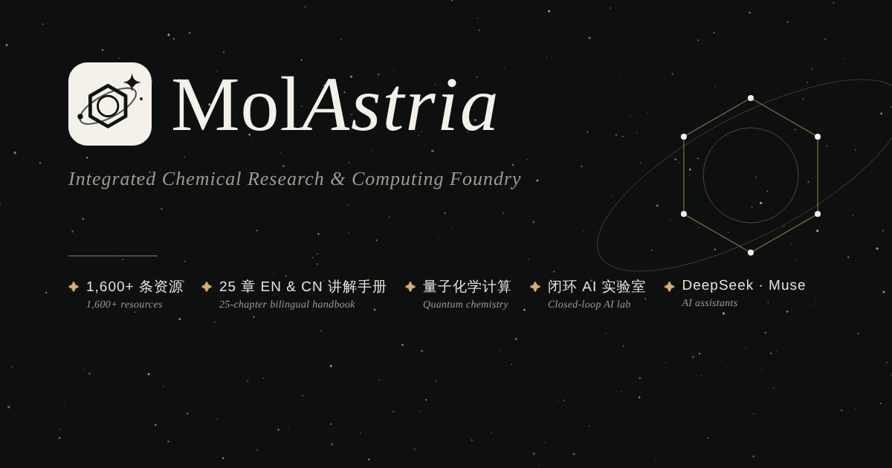

<p align="center"><a href="https://molastria.com/"></a></p>

<h1 align="center">MolAstria</h1>

<p align="center"><b>计算化学研究导航 · A computational chemistry atlas</b><br>
<a href="https://molastria.com/">molastria.com</a> · <a href="https://molastria.com/lab/">AI 实验室 / AI Lab</a> · <a href="https://molastria.com/?lang=en">English</a></p>

数据库、软件、教程、论文与开源工具一处检索（2,600 多条，每周四自动更新），配 20 章中英双语讲解手册、计算化学期刊投稿指南、27 个科学大模型的官方链接与价格对比、用站长 GPU 上 15 个机器学习原子间势在线计算的模型接口（13 种计算）、以查询为中心的资源关系网、浏览器里的量子化学计算、预印本雷达、Meta × 化学（Muse 识图与 UMA 脚本），以及用 DeepSeek / Meta Muse 驱动的闭环电解液分子发现实验室。全站支持中文 / English、浅色 / 深色和 10 种艺术背景，另有 Windows / macOS 桌面版；平板和手机上可以把网站添加到主屏幕，全屏使用，看过的页面断网也能读。

One place to search computational-chemistry databases, software, tutorials, papers and open-source tools (2,600+ entries, refreshed every Thursday), with a 20-chapter handbook in Chinese and English, a guide to computational chemistry journals, official links and a price comparison for 27 scientific language and multimodal models, a Model API that runs 13 kinds of calculation on 15 machine-learning interatomic potentials hosted on the site owner's GPU, a query-centred resource network, quantum chemistry in the browser, PreprintRadar, a Meta × Chemistry page (Muse image-to-structure and UMA scripts), and a closed-loop AI lab for electrolyte molecule discovery powered by DeepSeek or Meta Muse. The whole site switches between Chinese and English, light and dark, and 10 artistic backgrounds; there is also a Windows / macOS desktop app, and on tablets and phones the site can be added to the Home Screen to run full screen, with pages you have opened readable offline.

纯静态网站：`public/` 就是发布目录，不需要后端。 · A static site: `public/` is the published folder; no backend is needed.

## 视频导览 · Video tour

### 完整视频导览 · Full video tour

[在播放页面观看完整视频 · Watch the full video tour](https://molastria.com/watch/)

https://github.com/user-attachments/assets/879a28c3-d4e2-4244-aa9b-3e5f0cbb5ea0


三段短片，都有声音：先看 80 秒的介绍，再看网状查询导览和深色模式下的全站导览。 · Three short films with sound: an 80-second introduction, then a tour of the network and a tour of the whole site in dark mode.

### 介绍短片 · Introduction
https://github.com/user-attachments/assets/0bb5cc3d-f832-4ef3-95ef-c0ed371b0911


### 网状查询导览 · Network tour
https://github.com/user-attachments/assets/701d454d-34fd-414a-8e73-a1f41ff7e14f


### 深色模式导览 · Dark-mode tour
https://github.com/user-attachments/assets/31c3bf7b-e4e8-4121-bd8b-750b62277c0a


## 栏目 · Sections

| 栏目 Section | 路径 Path | 说明 What it does |
| --- | --- | --- |
| 统一搜索 Search | `public/index.html` | 2,600 多条去重资源（每周四自动更新）的多关键词检索、筛选、收藏与 CSV 导出（“收藏夹”按钮同时列出在数据库页收藏的资源）；中文术语能搜到英文条目，问句自动近似匹配，结果少时引导去问 AI、雷达和网状查询。<br>Keyword search, filters, saved items (the "Saved" button also lists resources saved on the Databases page) and CSV export over 2,600+ deduplicated resources (refreshed every Thursday); Chinese terms find English entries, natural-language questions fall back to fuzzy matching, and few results lead on to the AI assistant, PreprintRadar and the network. |
| 网状查询 Network | `public/hub/network.html` | 输入一个词，它就是网的中心：周围是关系最紧的软件、方法与概念，再外一圈是它们的近邻、相关条目和来源，点任何节点换中心。节点和连线由全部条目、讲解手册与中英术语表现算（`hub/net-engine.js`），认得同义词、前缀和拼写错误；数据每周四自动更新。<br>Type a term and it becomes the centre of the network, surrounded by the most closely related software, methods and concepts, their neighbours, the matching entries and their sources; click any node to recentre. Nodes and links are computed from every entry, the handbook and the Chinese–English term table, with synonyms, prefixes and misspellings understood. The data refreshes every Thursday. |
| 讲解手册 Explainer Handbook | `public/manual/index.html` | 20 章说明讲解手册的阅读器：目录、中文 / English 切换、打印、上一章 / 下一章，地址 `manual/index.html#<章节 id>` 直达某一章（旧地址 `atlas/index.html#guide/<id>` 自动跳过来）。正文数据在 `atlas/content.js` 和 `atlas/guides-en.js`；给搜索引擎的静态版在 `guide/`。<br>Reader for the 20-chapter handbook: contents, Chinese / English switch, print, previous / next; `manual/index.html#<chapter id>` opens a chapter, and old `atlas/index.html#guide/<id>` links redirect here. The text lives in `atlas/content.js` and `atlas/guides-en.js`; the static copy for search engines is `guide/`. |
| 数据库 Databases | `public/atlas/index.html` | 214 条数据库与研究资源目录（17 类，含量子化学程序、凝聚态第一性原理、波函数分析、量子力学与量子化学课程、量子计算化学、科学领域语言模型与多模态基础模型），可按类别、接入状态筛选和搜索，可下载 CSV；`#agent` 是 Agent 工程页（chemdb-agent 0.2.0：跨库检索晶体、分子与量子化学数据并导出训练集，源码在 `agent/chemdb-agent/`）。<br>214-entry catalogue of databases and research resources in 17 categories (including quantum chemistry programs, condensed-matter codes, wavefunction analysis, quantum mechanics courses, quantum computing for chemistry, and scientific language and multimodal foundation models), with filters, search and a CSV download; `#agent` is the Agent engineering page (chemdb-agent 0.2.0, source in `agent/chemdb-agent/`). |
| 期刊发表 Journals | `public/journals/index.html` | 46 种量子化学与计算化学期刊和 2 个预印本平台的投稿要点（只写期刊或出版社官网核实过的内容，每项附出处和核对日期，不写分区），可按类别、出版社、开放获取方式、文章类型筛选；另有 18 章“从研究到发表”指导。<br>Submission essentials for 46 quantum and computational chemistry journals and 2 preprint servers (only what the journal or publisher site states, each with its source and check date; no quartile rankings), with filters, plus an 18-chapter guide from research to publication. |
| 科学大模型 Science models | `public/scimodels/index.html` | 数据库第 17 类的 27 个科学领域语言模型与多模态基础模型，按 6 个子类分组：能力、规模、许可、已知限制，Hugging Face、在线体验（只列模型方自己的入口）和发布原文链接，可按访问方式（付费 API、免费注册、免费演示、开放权重、仅论文）筛选；价格对比图只放官方价格页写明的按 token 价格（Hydrogen-1.0，以及 7 家主流服务商的 13 个旗舰和小型模型），人民币按核对当天的中国外汇交易中心中间价换算，附核对日期和出处。<br>The 27 scientific language and multimodal foundation models from catalogue category 17, in 6 groups: capabilities, size, licence, known limits, and links to Hugging Face, the owner's own demo or API, and the release; filter by access (paid API, free with registration, free demo, open weights, paper only). The price chart shows only per-token prices stated on official pricing pages (Hydrogen-1.0, plus 13 flagship and small models from 7 mainstream providers), with RMB converted at the CFETS central parity of the check date, each with its source and check date. |
| 论文与社区 Papers & community | `public/hub/index.html` | 来源接入状态、内容分布、论文与教程快照；中文来源和国际来源（Stack Exchange、Discourse 论坛、博客、Crossref 期刊、arXiv、GitHub 发布说明）各占一半左右。<br>Source status, content charts, paper and tutorial snapshots; about half the entries come from international sources (Stack Exchange, Discourse forums, blogs, Crossref journals, arXiv, GitHub releases). |
| 预印本雷达 PreprintRadar | `public/radar/` | 同时检索 arXiv、ChemRxiv、bioRxiv 等 12 个预印本平台，按兴趣主题定时推荐、一键导出 PDF；是独立项目 [PreprintRadar](https://github.com/FelixJiashengFu/PreprintRadar) 的网页版，用 `tools/vendor-radar.ts` 复制进来，跟随本站的深浅色和中英文。<br>Search 12 preprint servers, scheduled recommendations and PDF export: the web build of the separate PreprintRadar project, copied in by `tools/vendor-radar.ts` and following this site's theme and language. |
| 量子化学 Quantum chemistry | `public/qchem/` | 在浏览器里做量子化学和量子点计算：HF/DFT、MP2、CCSD(T)、FCI、激发态、几何优化与振动频率，VQE 和量子相位估计，以及胶体量子点、石墨烯量子点和硅纳米团簇；每个模块都与 PySCF 逐项对拍。来自独立项目 [QChem Web](https://github.com/FelixJiashengFu/qchem-web)，用 `tools/vendor-qchem.ts` 复制进来。<br>Quantum chemistry and quantum dots in the browser: HF/DFT, MP2, CCSD(T), FCI, excited states, geometry optimisation and frequencies, VQE and phase estimation, and colloidal, graphene and silicon quantum dots, each module checked against PySCF. Copied in from the separate QChem Web project by `tools/vendor-qchem.ts`. |
| 训练 Agent Train an agent | `public/train/index.html` | 用开源小模型训练化学研究 Agent（模型表每周四自动对照 Hugging Face 核对链接、下载量，并列出近两个月各家新发布的小模型）：2026-10 最新小模型（LFM3、Qwen3.5、Gemma 4、Nemotron 3.5、Granite 4.2、MiniCPM5 等）与化学专用模型对比，每个模型可展开详细介绍；数据构造、LoRA、GRPO、评测与本地部署代码。<br>Train a chemistry research agent on an open small model: an October 2026 comparison of small and chemistry-specific models with expandable details, plus data, LoRA, GRPO, evaluation and local-deployment code. |
| Pro 与下载 Pro & downloads | `public/pro/`, `public/download/` | 价格页与结账窗口（Stripe 托管结账，填好 `public/pay/config.js` 的收款链接即可收款，步骤见 [PAYMENTS.md](PAYMENTS.md)），账号页（付款后自动登录、邮箱验证码登录、AI 托管额度、每周精选和邮件推送、课题组成员；站长永久 Pro，可以发 VIP 卡送朋友开通），服务条款、退款与隐私政策；Windows / macOS 桌面版下载（电脑浏览器里其他页面的左下角有可收起的“下载桌面版”浮窗），以及 iPad / iPhone / 安卓添加到主屏幕的步骤（平板上浮窗变成“添加到主屏幕”）。<br>Pricing page and checkout window (hosted Stripe checkout: add your links to `public/pay/config.js`, see PAYMENTS.md), account page (sign-in after payment or by email code, hosted AI quota, weekly picks by email, group members; the site admin has Pro for good and can issue VIP cards that give friends Pro), terms, refund and privacy pages; Windows and macOS downloads (on desktop browsers, other pages show a foldable "Download Desktop" card in the bottom-left corner), and steps for adding the site to the Home Screen on iPad, iPhone and Android (on tablets the card becomes "Add to Home Screen"). |
| AI 实验室 AI Lab | `public/lab/index.html` | 闭环电解液分子发现工作台（见下）。<br>Closed-loop electrolyte discovery workbench (below). |
| Meta × 化学 Meta × Chemistry | `public/meta/index.html` | Muse Spark 识图：从结构图得到 SMILES，RDKit 逐个校验；UMA 脚本生成器：按分子生成 fairchem + ASE 脚本（几何优化、构象搜索、分子动力学、绝热 IP/EA），IP/EA 结果可导入 AI 实验室；桌面版可以用本机 Python 一键运行；FAIR Chemistry 开放的模型与数据集目录（UMA、OMol25、OMat24、OC25、OPoly26 等）。<br>Muse Spark reads structure images into SMILES, checked by RDKit; a UMA script generator writes fairchem + ASE scripts (optimisation, conformers, MD, adiabatic IP/EA) whose IP/EA output imports into the AI Lab, and the desktop app runs it with your own Python; a catalogue of FAIR Chemistry's open models and datasets. |
| 模型接口 Model API | `public/models/index.html` | 站长 GPU 上的 15 个机器学习原子间势（Meta 的 UMA、AllScAIP、eSEN，MACE-OMOL-0、MACE-OFF23、MACE-MDP 和 ANI-2x），按类别分成 4 个窗口：带电荷与自旋的分子模型、中性分子通用模型、有机分子力场、分子性质模型。输入 SMILES 或 XYZ 就能在线做 13 种计算：单点能与受力、几何优化、振动频率与热化学、构象搜索、二面角扫描、分子动力学、反应能、电离能与电子亲和能、自旋态能隙、键解离能、质子亲和能、偶极矩与极化率、红外与拉曼光谱，可以让几个模型跑同一个计算对比。请求经账号服务的 `api.molastria.com/uma/*` 转到站长电脑上的服务（`tools/uma-server/`），按计算花费扣每日次数：Meta 的模型（UMA、AllScAIP、eSEN）每位访客每天共 40 次、Pro 200 次，MACE 系列每人 40 次，ANI-2x 只给 Pro（200 次）。结果是机器学习势的预测，不是 DFT。<br>15 machine-learning interatomic potentials on the site owner's GPU (Meta's UMA, AllScAIP and eSEN, plus MACE-OMOL-0, MACE-OFF23, MACE-MDP and ANI-2x) in 4 windows by kind: charged and open-shell molecules, neutral molecules, organic force fields and molecular properties. Enter SMILES or XYZ and run 13 job types online: single point, optimisation, frequencies and thermochemistry, conformer search, dihedral scan, molecular dynamics, reaction energy, ionisation energy and electron affinity, spin-state gap, bond dissociation energy, proton affinity, dipole and polarisability, and IR and Raman spectra; several models can run the same job for comparison. Requests go through the account service at `api.molastria.com/uma/*` to the server on the owner's machine (`tools/uma-server/`), and each job costs part of a daily allowance: 40 a day per visitor shared across Meta's models (UMA, AllScAIP, eSEN; 200 with Pro), 40 for the MACE models for everyone, and ANI-2x for Pro only (200). Results are machine-learning predictions, not DFT. |
| AI 研究助手 AI research assistant | 每页右上角 · top right（`public/ai/`） | 从右侧滑出的面板：“问目录”先检索本站再带出处作答，“自由提问”直接对话。标题旁可以切换服务商和模型（DeepSeek、Meta Muse、任意 OpenAI 兼容接口；登录 Pro 后多一个不用 key 的“MolAstria Pro”托管额度），左边缘可拖宽，双击恢复默认。打开面板时播一段片头，点击或按任意键跳过，可在背景面板里关掉。<br>A panel that slides in from the right: "Ask the catalogue" retrieves site entries and answers with citations; "Open question" talks to the model directly. The chip next to the title switches provider and model (DeepSeek, Meta Muse, any OpenAI-compatible API, and with Pro a hosted "MolAstria Pro" quota that needs no key); drag the left edge to widen it, double-click to reset. Opening the panel plays a short intro film; click or press any key to skip it, or turn it off in the background panel. |
| 静态页 Static pages | `public/guide/`, `public/resources/` | 给搜索引擎的讲解章节与资源目录（`tools/build-seo.ts` 生成）。<br>Guide chapters and resource directory for search engines, generated by `tools/build-seo.ts`. |

## AI 实验室 · AI Lab

按《Closed-Loop AI Scientist: A Ten-Day Plan for Electrolyte Molecule Discovery》的六步闭环实现。 · Implements the six-step loop of the *Closed-Loop AI Scientist* plan.

1. **提出 Propose** — Muse Wonder / DeepSeek 以 JSON 给出 SMILES 与设计理由，提示词自动带上当前 Pareto 前沿、上一轮被过滤的分子和被 DFT 推翻的判断。<br>The model returns SMILES with a design rationale; the prompt carries the current Pareto front, last round's rejects and DFT-overturned results.
2. **RDKit 过滤 Filter** — 浏览器里的 RDKit.js：元素（C/H/O/F，可放宽 N/S/P/B）、≤ 20 个重原子、危险基团、合成复杂度、InChIKey 去重、与 9 个种子溶剂的相似度。<br>RDKit.js in the browser: allowed elements, ≤ 20 heavy atoms, hazardous groups, synthetic complexity, InChIKey de-duplication, similarity to nine seed solvents.
3. **计算结果 Results** — 生成 rowan-python 脚本（Tier 1 UMA / Tier 2 氧化还原电位 / Tier 3 ωB97M-V，先 `is_draft=True` + `dispatch_info()` 估价），导入 CSV / JSON。<br>Generates rowan-python scripts for the three tiers (estimate first with `is_draft=True` + `dispatch_info()`) and imports CSV / JSON results.
4. **可靠性层 Reliability** — 先验误差、UMA-S/M 分歧、适用域、参考集距离、Rowan 警告，并可用已完成的 DFT 校准。<br>Prior error, UMA-S/M disagreement, applicability domain, distance from the reference set, Rowan warnings, with calibration from finished DFT.
5. **前沿与预算 Front & budget** — IP–EA Pareto 前沿逐轮回放、超体积曲线，在 credits 预算内挑选最值得 DFT 的候选。<br>Round-by-round Pareto replay, hypervolume, and DFT picks within the round's credit budget.
6. **候选卡片 Cards** — 结构图、三级结果、DFT 确认 / 推翻、PubChem 新颖性，导出 Markdown 报告与 CSV。<br>Structures, tier results, DFT confirm / overturn, PubChem novelty, Markdown and CSV export.

「载入演示数据」的分子和过滤是真实的，数值是标注清楚的合成值。 · In the demo, molecules and filtering are real; the property values are clearly labelled synthetic.

## 语言与背景 · Language & backgrounds

- **中文 / English**：右上角 `EN` / `中` 切换，或在网址后加 `?lang=en`。界面文字由 `i18n/en.json` 提供（`tools/i18n-extract.ts` 抽取，`tools/i18n-translate.ts` 用 DeepSeek 补译空缺项，手改的译文不会被覆盖）；论坛帖子标题、讲解正文等原始内容保留原文。<br>Switch with `EN` / `中` in the header or add `?lang=en`. Interface text comes from `i18n/en.json` (extracted by `tools/i18n-extract.ts`; empty entries filled by DeepSeek in `tools/i18n-translate.ts`; hand edits are never overwritten). Source content such as forum titles and guide chapters stays as published.
- **背景 Backgrounds**：调色板按钮里有 10 种——素纸、格物方格、苯环蜂巢、立方晶格、势能面、电子云、分子星图、极光、宣纸、光谱；可调浓淡、开关动态效果，随深浅色自动变色（`public/backdrop.js`）；“徽标动画”开关统一关掉 AI 面板片头、下载页片头和首页徽标动画。<br>The palette button offers 10: plain paper, lab notebook, benzene honeycomb, crystal blocks, energy landscape, electron clouds, molecular constellations, aurora, rice paper and spectral lines, with a strength slider and a motion switch; colours follow light / dark mode (`public/backdrop.js`). A "Logo animation" switch turns off the AI panel's intro film, the download page's intro film and the home page's logo animation together.

## 接入 DeepSeek 与 Muse · Connecting DeepSeek and Muse

**A. 访客自带 key · Bring your own key（默认 default）** — 「AI 助手」→ 设置，选 DeepSeek（`https://api.deepseek.com`，`deepseek-flash` / `deepseek-v4-pro`）、Meta Muse（`https://api.meta.ai/v1`，`muse-spark-1.3` / `muse-wonder-1.0`）或任意 OpenAI 兼容接口。key 默认只存在当前标签页。<br>Open AI assistant → settings and pick DeepSeek, Meta Muse or any OpenAI-compatible API. The key stays in the current tab unless "remember" is ticked.

**B. 站点代理 · Site proxy** — 部署 `deploy/ai-proxy-worker.js` 到 Cloudflare Workers，key 存为 secret，把地址填进 `public/ai/config.js` 的 `proxy`；Worker 会检查来源网站、模型白名单与输出上限。<br>Deploy the Worker, store keys as secrets and set `proxy` in `public/ai/config.js`; the Worker checks the calling site, allowed models and output limits.

```powershell
$env:DEEPSEEK_API_KEY = "<key>"; deno run --allow-net --allow-env --allow-read tools/proxy-local.ts 8831 http://localhost:8830
```

## 发布与更新 · Publishing and updates

推送到 `main` 后，`.github/workflows/pages.yml` 会跑测试、重新生成 SEO 页面和 sitemap，并发布到 **https://molastria.com/**（`public/CNAME`）。Search Console 用 DNS TXT 验证 `molastria.com` 网域资源，再提交 `https://molastria.com/sitemap.xml`。<br>Pushing to `main` runs the tests, rebuilds the SEO pages and sitemap, and deploys to molastria.com. Verify the `molastria.com` domain in Search Console with a DNS TXT record, then submit the sitemap.

```powershell
deno run --allow-net --allow-read tools/serve.ts 8830              # 本地预览 · local preview of public/
# 或在 GitHub Codespaces 打开（已配置 .devcontainer）· or open in Codespaces: https://codespaces.new/FelixJiashengFu/chem-research-molastria
deno run --allow-read --allow-write tools/build-seo.ts             # SEO 页面与 sitemap · SEO pages and sitemap
deno run --allow-read --allow-write tools/i18n-extract.ts          # 抽取界面文字 · collect UI strings
deno run --allow-read --allow-write --allow-net --allow-env tools/i18n-translate.ts   # 补译并生成 public/i18n/en.js
deno run --allow-read --allow-write tools/theme.ts                 # 首页与 Atlas 的深色配色 · dark palette
deno run --allow-read --allow-write tools/bundle-single.ts         # 单文件离线版 · single-file offline build
python maintenance/refresh_data.py                                # 爬取各来源并重建目录（每周四 Actions 自动跑：gh workflow run refresh-data.yml）· rebuild the catalogue
deno run --allow-net --allow-read --allow-write tools/hub-chemrxiv.ts   # 刷新快照里的 ChemRxiv 计算化学预印本 · refresh ChemRxiv in the snapshot
node tools/check-catalogue.mjs                                     # 检查新快照没有缩水 · sanity-check a new snapshot
deno run --allow-read --allow-write tools/vendor-radar.ts         # 复制预印本雷达网页版（先在 ../PreprintRadar 运行 deno task web）· copy in PreprintRadar
node --test tools/lab-test.mjs                                     # 实验室逻辑测试 · lab logic tests
node tools/e2e/run.mjs                                             # 浏览器端到端测试（先 npm ci --prefix tools/e2e）· browser end-to-end checks
node tools/e2e/live.mjs                                            # 线上只读检查 · read-only checks of the live site
node tools/cloud/run.mjs candidates.csv                            # 在自己的云 GPU 上批量算 UMA IP/EA 和 MACE-OFF23 复核 · batch UMA + MACE-OFF23 on your own cloud GPU
```

**桌面版新版本 · Desktop releases.** 推送标签 `desktop-v0.1.2` 这样的版本号，`.github/workflows/desktop.yml` 会以标签里的版本号构建 Win 安装包和 Mac 磁盘镜像，用仓库密钥 `TAURI_SIGNING_PRIVATE_KEY` 给更新文件签名，并发布 `latest.json`。已安装的桌面版每次启动都会读取它，发现新版本就在右下角提示“立即更新”，下载、校验签名、安装并重启。签名私钥只存在站长电脑（`~/.tauri/molastria-updater.key`）和这个仓库密钥里，请另外备份；丢了它，旧版本就再也收不到更新。<br>Push a tag such as `desktop-v0.1.2`: the workflow builds both installers with that version, signs the update files with the `TAURI_SIGNING_PRIVATE_KEY` secret and publishes `latest.json`. Installed apps read it on every launch and offer "Update now", which downloads, verifies, installs and restarts. Back up the private key; without it, installed apps can never be updated again.

```powershell
git tag desktop-v0.1.2; git push origin desktop-v0.1.2
```

## 文件结构 · Layout

```text
public/                     发布目录 · published site
  index.html, app.js         统一搜索 · search
  shared-nav.css/.js         顶栏、主题、语言与背景按钮，Pro 与 AI 入口，左下角“下载桌面版”浮窗 · header, theme, language and background buttons, Pro and AI entries, bottom-left "Download Desktop" card
  i18n.js, i18n/en.js        中英切换与英文词典 · language switch and English dictionary
  backdrop.js                10 种艺术背景 · artistic backgrounds
  sw.js, offline.html, manifest.webmanifest, assets/pwa/   添加到主屏幕与离线阅读 · installable web app and offline reading
  assets/brand/              首页徽标动画与片头视频（转码的小文件）· logo animation and intro film
  ai/                        AI 接入层与 AI 研究助手面板 · AI layer and the AI research assistant panel
  lab/                       AI 实验室 · AI Lab
  meta/                      Meta × 化学：Muse 识图、UMA 脚本、开放资源 · Meta × Chemistry
  models/                    模型接口：15 个机器学习势、13 种在线计算 · Model API: 15 ML potentials, 13 job types
  train/                     训练 Agent · train an agent
  pro/, pay/                 价格、结账、账号页与条款，收款配置 · pricing, checkout, account, terms, payment config
  download/                  桌面版下载与添加到主屏幕 · desktop downloads and Home Screen steps
  manual/                    讲解手册阅读器 · Explainer Handbook reader
  atlas/                     数据库与 Agent 工程（手册正文数据也在这里）· databases, Agent engineering, handbook text
  journals/                  期刊发表 · journals and publishing guide
  scimodels/                 科学大模型与价格对比 · science models and price comparison
  hub/                       论文与社区、网状查询 · papers & community, network
  radar/                     预印本雷达（app/ 由 tools/vendor-radar.ts 复制）· PreprintRadar
  qchem/                     量子化学计算（app/ 由 tools/vendor-qchem.ts 复制）· quantum chemistry
  guide/, resources/         生成的静态页 · generated static pages
i18n/en.json                 英文译文源文件 · English strings (editable)
desktop/                     Tauri 桌面版（Win + Mac，GitHub Actions 构建）· desktop app
agent/chemdb-agent/          chemdb-agent 源码（计算化学 MCP 服务器，下载包由 tools/pack-chemdb-agent.py 生成）· chemdb-agent source
PAYMENTS.md                  开通收款步骤 · how to turn on payments
deploy/ai-proxy-worker.js    可选 AI 代理 · optional AI proxy
deploy/account-worker.js     Pro 账号服务（Cloudflare Worker + D1，PAYMENTS.md 第 4 节）· Pro accounts
tools/                       构建、翻译、测试脚本 · build, translation and test scripts
tools/uma-server/            模型接口的在线服务（站长电脑上的 server.py，经 api.molastria.com/uma/* 接入）· Model API server on the owner's machine
docs/                        维护文档：结构、操作手册、决定记录、路线图 · maintainer docs
CLAUDE.md                    给 Claude Code 的项目说明 · project notes for Claude Code
maintenance/                 目录爬虫与合并（Python，每周四由 .github/workflows/refresh-data.yml 运行）· catalogue crawler
.devcontainer/               GitHub Codespaces 开发环境 · Codespaces dev container
site.config.json             正式网址与站名 · site URL and name
```

## 数据与局限 · Data and limits

目录数据每周四自动抓取更新（某个来源抓不到时沿用上一周的条目）；只收标题、短摘要和原文链接，全文与使用许可以原站为准。实验室的局限：电位工作流溶剂固定为乙腈，只适合相对排序；忽略阴离子与电极界面；不考虑黏度、闪点等宏观性质；合成复杂度是启发式近似。<br>The catalogue is re-crawled every Thursday (a source that cannot be reached keeps last week's entries); only titles, short excerpts and links are kept, and full text and licences belong to the original sites. Lab limits: the redox workflow uses acetonitrile, so potentials suit relative ranking only; anions and the electrode interface are ignored; bulk properties such as viscosity and flash point are not considered; synthetic complexity is a heuristic.
