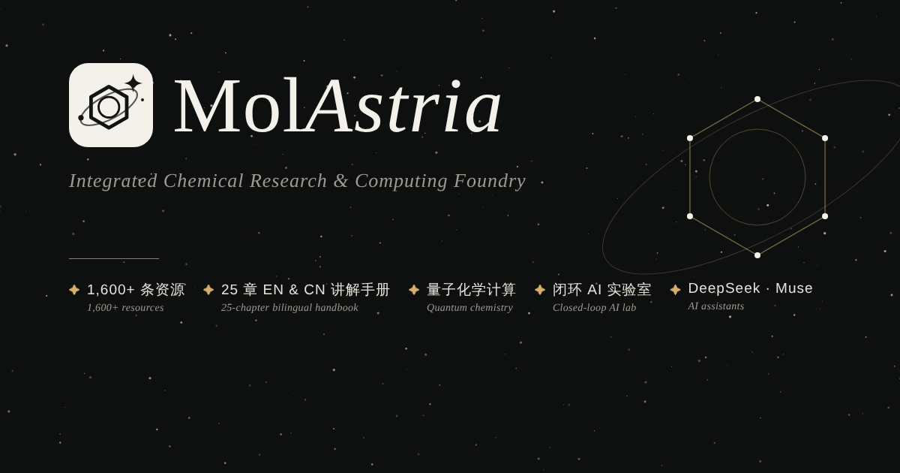
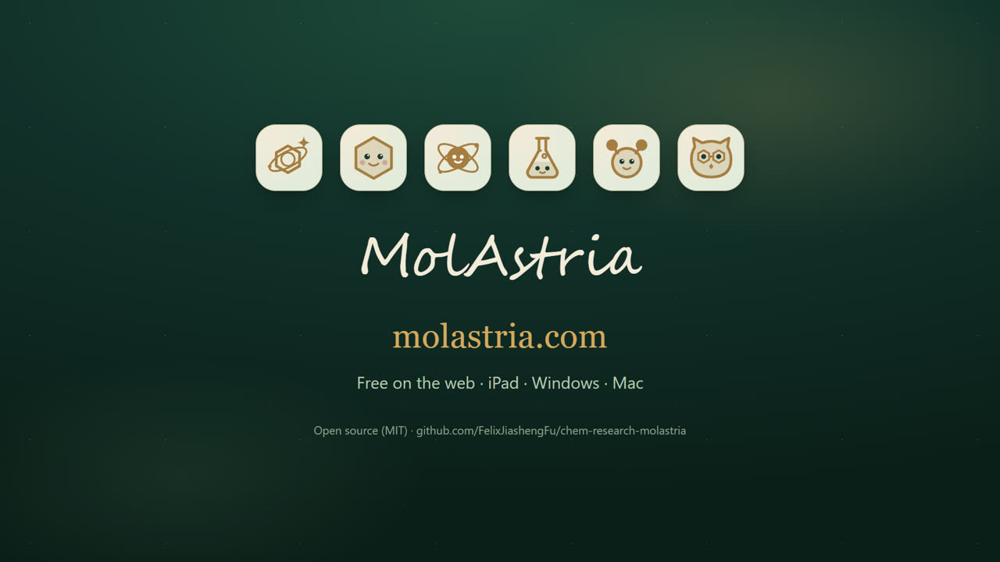

<p align="center"><a href="https://molastria.com/"></a></p>

<h1 align="center">MolAstria</h1>

<p align="center"><b>Integrated Chemical Research & Computing Foundry</b><br>
<a href="https://molastria.com/">molastria.com</a> · <a href="https://molastria.com/lab/">AI 实验室 / AI Lab</a> · <a href="https://molastria.com/?lang=en">English</a> · <a href="https://github.com/FelixJiashengFu/chem-research-molastria/releases/latest">桌面版下载 / Desktop downloads</a></p>

数据库、软件、教程、论文与开源工具一处检索（2,600 多条，来自 24 个中英文来源，每周四自动更新），配 25 章中英双语讲解手册、AI 家教“研习台”（先摸底、画路线、一步一检、分开练习，学到的积累成知识图）、189 条计算化学教学视频（YouTube 和哔哩哔哩的课程与软件教程，可在页面里播放）、计算化学期刊投稿指南、27 个科学大模型的官方链接与价格对比、用站长 GPU 上 15 个机器学习原子间势在线计算的模型接口（13 种计算）、每周精选论文、以查询为中心的资源关系网、游乐场（量子化学、量子嘉年华、物理疆界和 3D 立体馆四个展区的二十个小游戏，以及浏览器里的量子化学计算器）、量子嘉年华（量子物理、量子计算机、量子算法、量子生物学四个展馆）、物理疆界图、进一步基础科学发现与数学基础、中美研究图谱、28 个平台的预印本雷达、Meta × 化学（Muse 识图与 UMA 脚本），用 DeepSeek / Meta Muse 驱动的闭环电解液分子发现实验室，以及给程序用的开放数据接口（中英双语的静态 JSON，CC BY 4.0）和带 API key 的计算接口。全站支持中文 / English、浅色 / 深色、10 种艺术背景、可调的缩放字号字体和可自己排序的导航，另有 Windows / macOS 桌面版；平板和手机上可以把网站添加到主屏幕，全屏使用，看过的页面断网也能读。

One place to search computational-chemistry databases, software, tutorials, papers and open-source tools (2,600+ entries from 24 Chinese and international sources, refreshed every Thursday), with a 25-chapter handbook in Chinese and English, a guide to computational chemistry journals, official links and a price comparison for 27 scientific language and multimodal models, a Model API that runs 13 kinds of calculation on 15 machine-learning interatomic potentials hosted on the site owner's GPU, Weekly Picks, a query-centred resource network, a playground (twenty games across quantum chemistry, the Quantum Carnival, the Realms of Physics and a 3D hall, plus an in-browser quantum chemistry calculator), the Quantum Carnival (four pavilions: quantum physics, quantum computers, quantum algorithms, quantum biology), the Realms of Physics map, Advancing Fundamental Science with its mathematics module, a China–US research atlas, PreprintRadar across 28 servers, a Meta × Chemistry page (Muse image-to-structure and UMA scripts), a closed-loop AI lab for electrolyte molecule discovery powered by DeepSeek or Meta Muse, and, for programs, an open data API (bilingual static JSON, CC BY 4.0) and a compute API with API keys. The whole site switches between Chinese and English, light and dark, and 10 artistic backgrounds, with display settings and a header you can rearrange; there is also a Windows / macOS desktop app, and on tablets and phones the site can be added to the Home Screen to run full screen, with pages you have opened readable offline.

除此之外，网站还有：用 Google 登录；世界模型、AI 蛋白质设计、计算工作台、文献信息抽取、论文工坊几个新栏目；十四门学科的化学学科馆、核磁共振、谱图馆（91 种分析方法），以及“热、统计与流体”、光学、准粒子、群论、密度泛函理论、反应动力学、电磁学与介电、张量网络、光化学与激发态、分子动力学与自由能、NequIP、化学机器学习、前沿 AI 数学这些带现算演示的讲解栏目；讨论室、化学与材料新闻、书架和小宠物；还有八个接进来的开源工具：NMRium 谱图处理、在线模型上的过渡态搜索与 NEB（Sella）、AIMNet2、代码台的晶体声子（phonopy）、照 GoodVibes 移植的热化学、Mol* 大分子查看器、化学机器学习里的 Chemiscope 结构–性质图，以及文献抽取里的 MolNexTR 结构识别。

The site also has Sign in with Google; three new sections, World Models, the Workbench and the Literature Extractor; the Chemistry Disciplines section with fourteen halls, NMR and the Spectra Hall (91 analytical methods), plus explainer sections with live demos on heat, statistics and flow, optics, quasiparticles, group theory, density functional theory, reaction kinetics, electromagnetism and dielectrics, tensor networks, photochemistry and excited states, molecular dynamics and free energy, NequIP, chemistry machine learning and frontier AI maths; Discussion Rooms, Chemistry News, a Bookshelf and Pets; and eight open-source tools built in: NMRium spectrum processing, transition-state search and NEB on the online models (Sella), AIMNet2, crystal phonons in the Code Desk (phonopy), thermochemistry ported from GoodVibes, the Mol* macromolecule viewer, a Chemiscope structure–property map in Chemistry ML, and MolNexTR structure recognition in the Literature Extractor.

纯静态网站：`public/` 就是发布目录，不需要后端。 · A static site: `public/` is the published folder; no backend is needed.

## 阿斯特赖亚科技 · Morning Glory

MolAstria 是阿斯特赖亚科技（Morning Glory）旗下的 AI 与科学计算项目。Morning Glory 是 16513778 Canada Inc.（加拿大联邦注册公司，多伦多）发展的科技品牌，关注 AI 应用、智能自动化、数据科学与科学计算，长期希望参与 AI 与基础科学的交叉研究。目前对外的产品只有 MolAstria，其他方向都在规划中。介绍见 [关于页](https://molastria.com/about/)。

MolAstria is the AI & Scientific Computing project of Morning Glory, a Toronto-based emerging technology brand being developed under 16513778 Canada Inc. (a Canadian federal corporation), with a focus on AI applications, intelligent automation, data analytics and scientific computing. MolAstria is its only public product today; the other directions are planned. See the [About page](https://molastria.com/about/).

> **Intelligence Beyond Boundaries.** 智能无界，探索未知。<br>From Artificial Intelligence to Scientific Discovery. 从人工智能到科学发现。

## 视频导览 · Video tour

### 发布短片 · Launch film（2 分钟 · 2 min）

两分钟带你走一遍 MolAstria（英文配音，有声音）。点封面播放。 · A two-minute walk through MolAstria, with English voice-over. Click the cover to play.

<a href="docs/media/MolAstria-launch.mp4"></a>

[播放视频 · Play the video（mp4，9 MB）](docs/media/MolAstria-launch.mp4) · [在 X 上观看 · Watch on X](https://x.com/fu_jiasheng/status/2119209635509055915)

### 完整视频导览 · Full video tour

[在播放页面观看完整视频 · Watch the full video tour](https://molastria.com/watch/)


三段较早的短片，都有声音：先看 80 秒的介绍，再看网状查询导览和深色模式下的全站导览。 · Three earlier short films with sound: an 80-second introduction, then a tour of the network and a tour of the whole site in dark mode.

### 介绍短片 · Introduction
https://github.com/user-attachments/assets/0bb5cc3d-f832-4ef3-95ef-c0ed371b0911


### 网状查询导览 · Network tour
https://github.com/user-attachments/assets/701d454d-34fd-414a-8e73-a1f41ff7e14f


### 深色模式导览 · Dark-mode tour
https://github.com/user-attachments/assets/31c3bf7b-e4e8-4121-bd8b-750b62277c0a


## 栏目 · Sections

| 栏目 Section | 路径 Path | 说明 What it does |
| --- | --- | --- |
| 统一搜索 Search | `public/index.html` | 2,600 多条去重资源（每周四自动更新）的多关键词检索、筛选、收藏与 CSV 导出（“收藏夹”按钮同时列出在数据库页收藏的资源）；中文术语能搜到英文条目，问句自动近似匹配，结果少时引导去问 AI、雷达和网状查询。<br>Keyword search, filters, saved items (the "Saved" button also lists resources saved on the Databases page) and CSV export over 2,600+ deduplicated resources (refreshed every Thursday); Chinese terms find English entries, natural-language questions fall back to fuzzy matching, and few results lead on to the AI assistant, PreprintRadar and the network. |
| 网状查询 Network | `public/hub/network.html` | 输入一个词，它就是网的中心：周围是关系最紧的软件、方法与概念，再外一圈是它们的近邻、相关条目和来源，点任何节点换中心。节点和连线由全部条目、讲解手册与中英术语表现算（`hub/net-engine.js`），认得同义词、前缀和拼写错误；数据每周四自动更新。<br>Type a term and it becomes the centre of the network, surrounded by the most closely related software, methods and concepts, their neighbours, the matching entries and their sources; click any node to recentre. Nodes and links are computed from every entry, the handbook and the Chinese–English term table, with synonyms, prefixes and misspellings understood. The data refreshes every Thursday. |
| 讲解手册 Explainer Handbook | `public/manual/index.html` | 25 章说明讲解手册的阅读器：目录、中文 / English 切换、打印、上一章 / 下一章，地址 `manual/index.html#<章节 id>` 直达某一章（旧地址 `atlas/index.html#guide/<id>` 自动跳过来）。正文数据在 `atlas/content.js` 和 `atlas/guides-en.js`；给搜索引擎的静态版在 `guide/`。<br>Reader for the 25-chapter handbook: contents, Chinese / English switch, print, previous / next; `manual/index.html#<chapter id>` opens a chapter, and old `atlas/index.html#guide/<id>` links redirect here. The text lives in `atlas/content.js` and `atlas/guides-en.js`; the static copy for search engines is `guide/`. |
| 教学视频 Teaching Videos | `public/videos/index.html` | 从 YouTube 和哔哩哔哩收集的 189 条计算化学课程、讲座和软件教程，按 14 个主题分组，可按平台、语言、程度筛选和搜索。点封面在页面里播放（播放器点了才加载），不能嵌入的打开原视频，每条下面都有原视频链接；标题和频道照平台原文，说明中英两版。数据在 `videos/videos-data.js`，封面发布时由 `tools/video-thumbs.mjs` 下载。<br>189 computational-chemistry courses, lectures and software tutorials from YouTube and Bilibili in 14 topics, with filters by platform, language and level and a search. Click a cover to play it on the page (the player loads only on click); videos that cannot be embedded open the original, and every card links to it. Titles and channels are the platforms' own; the notes are in Chinese and English. Data: `videos/videos-data.js`; covers are downloaded at release time by `tools/video-thumbs.mjs`. |
| 数据库 Databases | `public/atlas/index.html` | 253 条数据库与研究资源目录（17 类，含量子化学程序、凝聚态第一性原理、波函数分析、量子力学与量子化学课程、量子计算化学、科学领域语言模型与多模态基础模型），可按类别、接入状态筛选和搜索，可下载 CSV；`#agent` 是 Agent 工程页（chemdb-agent 0.3.0：跨库检索晶体、分子与量子化学数据并导出训练集，源码在 `agent/chemdb-agent/`）。<br>253-entry catalogue of databases and research resources in 17 categories (including quantum chemistry programs, condensed-matter codes, wavefunction analysis, quantum mechanics courses, quantum computing for chemistry, and scientific language and multimodal foundation models), with filters, search and a CSV download; `#agent` is the Agent engineering page (chemdb-agent 0.3.0, source in `agent/chemdb-agent/`). |
| 期刊发表 Journals | `public/journals/index.html` | 46 种量子化学与计算化学期刊和 2 个预印本平台的投稿要点（只写期刊或出版社官网核实过的内容，每项附出处和核对日期，不写分区），可按类别、出版社、开放获取方式、文章类型筛选；另有 18 章“从研究到发表”指导。<br>Submission essentials for 46 quantum and computational chemistry journals and 2 preprint servers (only what the journal or publisher site states, each with its source and check date; no quartile rankings), with filters, plus an 18-chapter guide from research to publication. |
| 科学大模型 Science models | `public/scimodels/index.html` | 数据库第 17 类的 27 个科学领域语言模型与多模态基础模型，按 6 个子类分组：能力、规模、许可、已知限制，Hugging Face、在线体验（只列模型方自己的入口）和发布原文链接，可按访问方式（付费 API、免费注册、免费演示、开放权重、仅论文）筛选；价格对比图只放官方价格页写明的按 token 价格（Hydrogen-1.0，以及 7 家主流服务商的 13 个旗舰和小型模型），人民币按核对当天的中国外汇交易中心中间价换算，附核对日期和出处。<br>The 27 scientific language and multimodal foundation models from catalogue category 17, in 6 groups: capabilities, size, licence, known limits, and links to Hugging Face, the owner's own demo or API, and the release; filter by access (paid API, free with registration, free demo, open weights, paper only). The price chart shows only per-token prices stated on official pricing pages (Hydrogen-1.0, plus 13 flagship and small models from 7 mainstream providers), with RMB converted at the CFETS central parity of the check date, each with its source and check date. |
| 论文与社区 Papers & community | `public/hub/index.html` | 来源接入状态、内容分布、论文与教程快照；中文来源和国际来源（Stack Exchange、Discourse 论坛、博客、Crossref 期刊、arXiv、GitHub 发布说明）各占一半左右。<br>Source status, content charts, paper and tutorial snapshots; about half the entries come from international sources (Stack Exchange, Discourse forums, blogs, Crossref journals, arXiv, GitHub releases). |
| 每周精选 Weekly Picks | `public/digest/` | 每周一从 ChemRxiv、arXiv 化学物理和 JCTC/JCP/PCCP/JPCL 的新论文里，由 AI 像编辑一样挑出约十篇、每篇一句解读；本周概览和前五篇对所有人公开（也显示在首页），完整一期和邮件推送是 Pro。<br>Every Monday about ten new computational chemistry papers, each with a one-line comment; the overview and first five are public (also on the home page), the full issue and the email are Pro. |
| 预印本雷达 PreprintRadar | `public/radar/` | 同时检索 arXiv、ChemRxiv、bioRxiv、SocArXiv、Knowledge Commons 等 28 个预印本平台与开放仓库（理工、医学、社科到人文），按兴趣主题定时推荐、一键导出 PDF；是独立项目 [PreprintRadar](https://github.com/FelixJiashengFu/PreprintRadar) 的网页版，用 `tools/vendor-radar.ts` 复制进来，跟随本站的深浅色和中英文。<br>Search 28 preprint servers and open repositories, from the sciences to the humanities, scheduled recommendations and PDF export: the web build of the separate PreprintRadar project, copied in by `tools/vendor-radar.ts` and following this site's theme and language. |
| 游乐场 Playground | `public/qchem/` | 二十个小游戏，分四个展区。量子化学（01–06）：盒中粒子调颜色、猜氢原子轨道、电子排布、量子隧穿闯关、Hückel 芳香性判断、氢原子光谱寻线；量子嘉年华分会场：Stern–Gerlach、CHSH 贝尔游戏、量子电路拼图、三比特纠错、Grover 搜索、噪声辅助能量传递、二维波包画墙；物理疆界：普朗克单位、ħ-c-G 立方体；立体馆（3D，可转动、拖动）：价层电子对排布、手性 R/S、密勒晶面、Bloch 球导航，以及站长写的 WebGL2 三维场景“量子世界”（原子、双缝、隧穿、纠缠）。物理和数学都是纯函数（`play-models.js`、`play-quantum-models.js`、`play-wave2d-models.js`、`play-3d-models.js`），用已知结果和解析解测试（`tools/play-test.mjs`），每个游戏写明模型的简化。成绩只存在浏览器里。<br>Twenty games in four halls. Quantum chemistry: particle-in-a-box colours, guess the hydrogen orbital, electron configurations, quantum tunnelling levels, Hückel aromaticity and hydrogen spectral lines; Quantum Carnival: Stern–Gerlach, the CHSH Bell game, a quantum circuit puzzle, three-qubit error correction, Grover search, noise-assisted energy transfer and drawing walls for a 2D wave packet; Realms of Physics: Planck units and the ħ-c-G cube; 3D hall (turn and drag): VSEPR electron pairs, R/S chirality, Miller planes and Bloch-sphere navigation, plus “Quantum world”, a WebGL2 scene by the site’s author (atom, double slit, tunnelling, entanglement). The physics and maths are pure functions tested against known results and analytic solutions, and each game states what its model leaves out.<br>另有量子化学计算器（“量子化学计算器”标签）：在浏览器里做量子化学和量子点计算：HF/DFT、MP2、CCSD(T)、FCI、激发态、几何优化与振动频率，VQE 和量子相位估计，以及胶体量子点、石墨烯量子点和硅纳米团簇；每个模块都与 PySCF 逐项对拍。来自独立项目 [QChem Web](https://github.com/FelixJiashengFu/qchem-web)，用 `tools/vendor-qchem.ts` 复制进来。<br>Quantum chemistry and quantum dots in the browser: HF/DFT, MP2, CCSD(T), FCI, excited states, geometry optimisation and frequencies, VQE and phase estimation, and colloidal, graphene and silicon quantum dots, each module checked against PySCF. Copied in from the separate QChem Web project by `tools/vendor-qchem.ts`. |
| 进一步基础科学发现 Advancing Fundamental Science | `public/fundamental-science/` | 量子力学的基础与局限、量子化学的数学重构（约化密度矩阵、N-可表示性、张量网络）、分子量子动力学的几何基础（Berry 相位、圆锥交叉、精确因子分解）、GRW / CSL 等修正动力学及其分子检验；每一条标明已确立、活跃研究、理论假说或计划方向，三条重点研究主线都处于计划阶段，不声称任何新发现。交互式理论实验室直接求解三个数学模型（GRW 局域化、两能级退相干、圆锥交叉的 Berry 相位），附 36 篇在 Crossref 核对过的文献；公式是预先生成的 MathML。<br>Foundations and limits of quantum mechanics, the mathematical reconstruction of quantum chemistry (reduced density matrices, N-representability, tensor networks), geometric foundations of molecular quantum dynamics (Berry phase, conical intersections, exact factorization), and modified dynamics such as GRW and CSL with their molecular tests. Every item is labelled established, active research, hypothesis or proposed direction; the three priority directions are at the planning stage and no discovery is claimed. The Interactive Theory Laboratory solves three mathematical models directly (a GRW localization, a two-level system with decoherence, the Berry phase around a conical intersection), with 36 references checked against Crossref; formulas are pre-rendered MathML. |
| 量子嘉年华 Quantum Carnival | `public/quantum/` | 量子母栏目，四个展馆：量子物理（`physics/`，三幕十二章、四个演示、原始论文、教材与课程）、量子计算机（`computing/`，六条硬件路线与量子纠错，每条标明确定程度）、量子算法（`algorithms/`，14 个算法，每个写明加速的证据等级，附化学问题的资源估算和态矢量模拟器）、量子生物学（`biology/`，七个方向的证据账本：已确立、活跃研究、存在争议、推测性假说）。文献在 Crossref / OpenAlex / arXiv 核对过，公式是预先生成的 MathML。<br>The quantum parent section with four pavilions: quantum physics (twelve chapters in three acts, four demos, original papers, textbooks and courses), quantum computers (six hardware routes and error correction, each claim labelled by certainty), quantum algorithms (14 algorithms, each with the evidence level of its speed-up, resource estimates for chemistry and a state-vector simulator) and quantum biology (an evidence ledger across seven directions: established, active research, disputed, speculative). References are checked against Crossref, OpenAlex or arXiv; formulas are pre-rendered MathML. |
| 研习台 Study Desk | `public/learn/` | AI 家教：先出几道摸底题，连同你有多确定、你是怎么想的，看清你已经会什么；再画一张从已会到目标的依赖路线；然后每次只讲一步、紧跟一道检查题，答错或靠猜答对就换个角度补一步。练习单独进行，题目跨主题穿插、不提前说考什么，提示一级一级给。学到的命题和推理链积累成跨会话的知识图，也可以导入笔记。可以从量子物理、数学基础等栏目的章节直接开始，站内核对过的内容作为依据。用你自己的 AI key（或登录后的托管额度），数据只存在本机，可导出，提示词可见可改。<br>An AI tutor: a short probe reads your answers together with how sure you are and how you reasoned, a dependency map runs from what you hold to the goal, then one step at a time with a check after each, and a repair from another angle when an answer is wrong or a lucky guess. Practice is separate, interleaved across topics without naming them, with hints one level at a time. What you learn builds a knowledge graph of claims and reasoning chains across sessions; notes can be imported. Sessions can start from a chapter of the site, using its checked content as grounding. Runs on your own AI key (or the hosted allowance when signed in); data stays on your device, exports as JSON, and the prompts are visible and editable. |
| 复习卡片 Review cards | `public/review/` | 读过的东西快要忘的时候再出现一次：中英术语、研习台知识图里的命题和推理链（只读），以及自己写的卡片，用开源的 FSRS 间隔重复算法（ts-fsrs）安排复习；可以导出到 Anki，也能备份到另一台设备。卡片和进度只存在浏览器里。<br>Cards come back just before you would forget them: Chinese–English terms, propositions and reasoning chains from the Study Desk knowledge graph (read only) and cards you write yourself, scheduled with the open FSRS spaced-repetition algorithm (ts-fsrs); export to Anki or back up to another device. Cards and progress stay in your browser. |
| 开源代码台 Code Desk | `public/code/` | 从 SMILES 直接生成三维坐标（OpenChemLib，几个构象、MMFF94 优化）；一个分子一键写出 PySCF、Psi4、xTB、CREST、ORCA、Gaussian、NWChem、CP2K、ASE 的输入和 QCSchema（先核对电荷和多重度）；读 xTB、ORCA、Psi4、Gaussian、PySCF、NWChem、CP2K、Q-Chem 的输出（能量、收敛、能隙、虚频）；模型接口算完的结构一键送进来；查一个软件包的版本、许可证能不能放进 MIT 项目、已知漏洞（OSV）和长期存档（Software Heritage）；跨 GitHub、Sourcegraph、grep.app、Software Heritage、Debian 搜代码。全部在浏览器里完成 · Code Desk: inputs, outputs, licence and vulnerability check-up, code search<br>后来加上的标签：“晶体声子”（`#phonon`）把晶体交给站长电脑上的 phonopy + spglib + seekpath，力来自 EMT（phonopy-emt）或 UMA 的 omat 任务，给出色散、态密度和热学量，每次扣 5 次；“quacc 流水线”（`#quacc`）一批最多 8 个分子交给站长电脑的 quacc 通道（GFN2-xTB、Psi4、EMT）；“化学信息学”算 RDKit.js 的描述符、Lipinski / Veber、SMARTS 和 Tanimoto。输出解读读到频率时出现热化学面板：GoodVibes 4.4.0 逐式移植成 JavaScript，给出 ZPE、H、T·S、G（RRHO 和 Grimme 等的准 RRHO），可以换 1 atm 或 1 mol/L、温度和校正因子，拿七份真实输出对照原版，每项差不到 1e-5 Eh。<br>Later tabs: Crystal phonons (`#phonon`) send a crystal to phonopy + spglib + seekpath on the owner's machine, with forces from EMT (phonopy-emt) or UMA's omat task, and return dispersion, density of states and thermal properties; each job costs 5 runs; the quacc pipeline (`#quacc`) sends up to 8 molecules at a time to the quacc channels on the owner's machine (GFN2-xTB, Psi4, EMT); Cheminformatics computes RDKit.js descriptors, Lipinski / Veber, SMARTS and Tanimoto. When an output has frequencies, a thermochemistry panel appears: GoodVibes 4.4.0 ported formula by formula to JavaScript, giving ZPE, H, T·S and G (RRHO and the quasi-RRHO corrections of Grimme and others), with 1 atm or 1 mol/L, temperature and scaling factors, checked against the original on seven real outputs to within 1e-5 Eh per term. |
| 物理疆界图 Realms of Physics | `public/physics-realms/` | 四十多个物理理论和它们能解释、解释不了的六十多个问题，画成可以拖动缩放的网状图；每个理论写明适用范围、在哪里失效、被哪个理论接替，另有 ħ-c-G 立方体。<br>Forty-odd physical theories and the sixty-odd problems they do and do not explain, drawn as a graph you can drag and zoom; each theory states where it applies, where it breaks down and what replaces it, with the ħ-c-G cube. |
| 研究图谱 Research Atlas | `public/research-atlas/` | 中美二十所大学数学、物理、化学教授的合作网络，量子化学 / 计算化学课题组地图，Top 20 学者档案，中美细分方向对比和北美计算化学产业报告，数据来自 OpenAlex。`app/` 由 `tools/vendor-atlas.mjs` 从独立项目复制，每月 5 日自动同步。<br>Collaboration networks of mathematics, physics and chemistry faculty at twenty Chinese and US universities, a map of quantum and computational chemistry groups, Top 20 profiles, China–US comparisons and a North American industry report, all from OpenAlex. `app/` is copied from a separate project by `tools/vendor-atlas.mjs` and re-synced on the 5th of each month. |
| 开放数据接口 Open data API | `public/api/` | 给程序读的静态 JSON（资源目录、期刊、科学大模型与价格、教学视频、中英术语表，中英双语，CC BY 4.0，不用注册），`openapi.json`、`llms.txt`，零依赖的 JS 库 `molastria.mjs` 和一行就能贴进别人网页的嵌入卡片 `embed.js`。说明页里还有计算接口：在账号页生成 API key，程序就能经 `api.molastria.com/v1` 提交在线模型计算。<br>Static JSON for programs (catalogue, journals, science models and prices, teaching videos and a bilingual glossary; CC BY 4.0, no sign-up), with `openapi.json`, `llms.txt`, a zero-dependency JS library and a one-line embeddable card. The same page documents the compute API: generate an API key on the account page and submit online-model jobs through `api.molastria.com/v1`. |
| 训练 Agent Train an agent | `public/train/index.html` | 用开源小模型训练化学研究 Agent（模型表每周四自动对照 Hugging Face 核对链接、下载量，并列出近两个月各家新发布的小模型）：2026-10 最新小模型（LFM3、Qwen3.5、Gemma 4、Nemotron 3.5、Granite 4.2、MiniCPM5 等）与化学专用模型对比，每个模型可展开详细介绍；数据构造、LoRA、GRPO、评测与本地部署代码。<br>Train a chemistry research agent on an open small model: an October 2026 comparison of small and chemistry-specific models with expandable details, plus data, LoRA, GRPO, evaluation and local-deployment code. |
| Pro 与下载 Pro & downloads | `public/pro/`, `public/download/` | 价格页与结账窗口（Stripe 托管结账，填好 `public/pay/config.js` 的收款链接即可收款，步骤见 [PAYMENTS.md](PAYMENTS.md)），账号页（付款后自动登录、邮箱验证码登录、AI 托管额度、每周精选和邮件推送、课题组成员；站长永久 Pro，可以发 VIP 卡送朋友开通），服务条款、退款与隐私政策；Windows / macOS 桌面版下载（电脑浏览器里其他页面的左下角有可收起的“下载桌面版”浮窗），以及 iPad / iPhone / 安卓添加到主屏幕的步骤（平板上浮窗变成“添加到主屏幕”）。<br>Pricing page and checkout window (hosted Stripe checkout: add your links to `public/pay/config.js`, see PAYMENTS.md), account page (sign-in after payment or by email code, hosted AI quota, weekly picks by email, group members; the site admin has Pro for good and can issue VIP cards that give friends Pro), terms, refund and privacy pages; Windows and macOS downloads (on desktop browsers, other pages show a foldable "Download Desktop" card in the bottom-left corner), and steps for adding the site to the Home Screen on iPad, iPhone and Android (on tablets the card becomes "Add to Home Screen").<br>账号页也可以用 Google 登录（账号服务的 `/auth/google/*`：OpenID Connect + PKCE，按 Google 确认过的邮箱认账号，所以老账号的 Pro、课题组和 API key 都还在；桌面版暂时不显示这个按钮），邮箱验证码照旧能用。登录后可以在账号页打开云同步，把研习台、复习卡片、我的学习、书架、小宠物等存档同步到别的设备。<br>The account page also offers Sign in with Google (`/auth/google/*` on the account service: OpenID Connect with PKCE, matched to the account by the email Google has verified, so existing Pro, group and API-key settings carry over; the button is not shown in the desktop app yet), and the email code still works. Once signed in, cloud sync can be turned on from the account page to sync the Study Desk, review cards, My Study, the Bookshelf, your pet and other saved progress across devices. |
| AI 实验室 AI Lab | `public/lab/index.html` | 闭环电解液分子发现工作台（见下）。<br>Closed-loop electrolyte discovery workbench (below). |
| Meta × 化学 Meta × Chemistry | `public/meta/index.html` | Muse Spark 识图：从结构图得到 SMILES，RDKit 逐个校验；UMA 脚本生成器：按分子生成 fairchem + ASE 脚本（几何优化、构象搜索、分子动力学、绝热 IP/EA），IP/EA 结果可导入 AI 实验室；桌面版可以用本机 Python 一键运行；FAIR Chemistry 开放的模型与数据集目录（UMA、OMol25、OMat24、OC25、OPoly26 等）。<br>Muse Spark reads structure images into SMILES, checked by RDKit; a UMA script generator writes fairchem + ASE scripts (optimisation, conformers, MD, adiabatic IP/EA) whose IP/EA output imports into the AI Lab, and the desktop app runs it with your own Python; a catalogue of FAIR Chemistry's open models and datasets. |
| 模型接口 Model API | `public/models/index.html` | 站长 GPU 上的 15 个机器学习原子间势（Meta 的 UMA、AllScAIP、eSEN，MACE-OMOL-0、MACE-OFF23、MACE-MDP 和 ANI-2x），按类别分成 4 个窗口：带电荷与自旋的分子模型、中性分子通用模型、有机分子力场、分子性质模型。输入 SMILES 或 XYZ 就能在线做 13 种计算：单点能与受力、几何优化、振动频率与热化学、构象搜索、二面角扫描、分子动力学、反应能、电离能与电子亲和能、自旋态能隙、键解离能、质子亲和能、偶极矩与极化率、红外与拉曼光谱，可以让几个模型跑同一个计算对比。请求经账号服务的 `api.molastria.com/uma/*` 转到站长电脑上的服务（`tools/uma-server/`），按计算花费扣每日次数：Meta 的模型（UMA、AllScAIP、eSEN）每位访客每天共 40 次、Pro 200 次，MACE 系列每人 40 次，ANI-2x 只给 Pro（200 次）。结果是机器学习势的预测，不是 DFT。<br>15 machine-learning interatomic potentials on the site owner's GPU (Meta's UMA, AllScAIP and eSEN, plus MACE-OMOL-0, MACE-OFF23, MACE-MDP and ANI-2x) in 4 windows by kind: charged and open-shell molecules, neutral molecules, organic force fields and molecular properties. Enter SMILES or XYZ and run 13 job types online: single point, optimisation, frequencies and thermochemistry, conformer search, dihedral scan, molecular dynamics, reaction energy, ionisation energy and electron affinity, spin-state gap, bond dissociation energy, proton affinity, dipole and polarisability, and IR and Raman spectra; several models can run the same job for comparison. Requests go through the account service at `api.molastria.com/uma/*` to the server on the owner's machine (`tools/uma-server/`), and each job costs part of a daily allowance: 40 a day per visitor shared across Meta's models (UMA, AllScAIP, eSEN; 200 with Pro), 40 for the MACE models for everyone, and ANI-2x for Pro only (200). Results are machine-learning predictions, not DFT.<br>现在共有七个窗口：除了上面四个，还有 xTB 的半经验方法（GFN2-xTB、加水溶剂的 GFN2-xTB、GFN1-xTB，在站长电脑的 CPU 上算；有机力场窗口里另有 GFN-FF）、用 OpenMM 按 PDB 编号跑蛋白质分子动力学（结果可以用 Mol* 按每个残基的涨落着色播放），以及 DBCata 的合金表面吸附结构（二元合金（A₃B、AB、AB₃，不收纯金属）的 (111) 面、12 种吸附物，能量用 UMA 的 oc20 任务算）。窗口 ① 加了 AIMNet2（MIT，只算闭壳层分子，离子可以，自由基不行）。几何类计算加了“过渡态搜索与 IRC”（5 次）和“NEB 找过渡态与 IRC”（8 次）：用 Sella 找鞍点和做 IRC，NEB 用 ASE，最多 50 个原子、只收 XYZ，结果能播放反应路径和虚频振动。加上 AIMNet2，机器学习原子间势现在是 16 个。每日次数现在分三档：匿名访客 40 次、免费账号 100 次、Pro 200 次；ANI-2x 已对所有人开放，和 Meta 的模型共用这份次数；MACE 仍是每人 40 次。<br>There are now seven windows: besides the four above, xTB's semi-empirical methods (GFN2-xTB, GFN2-xTB with water as implicit solvent, and GFN1-xTB, on the owner's CPU; GFN-FF sits in the organic force-field window), protein molecular dynamics with OpenMM from a PDB ID (results play back in Mol*, coloured by per-residue fluctuation), and DBCata adsorption structures on alloy surfaces ((111) faces of binary alloys (A₃B, AB, AB₃; pure metals are not accepted), 12 adsorbates, energies from UMA's oc20 task). Window ① adds AIMNet2 (MIT; closed-shell molecules only: ions are fine, radicals are not). The geometry jobs add transition-state search with IRC (5 runs per job) and NEB with IRC (8 runs per job): Sella finds the saddle point and runs the IRC, ASE runs the NEB, up to 50 atoms and XYZ input only, and the results can play back the reaction path and the imaginary-mode vibration. With AIMNet2 there are now 16 machine-learning interatomic potentials. The daily allowance now has three tiers: 40 for anonymous visitors, 100 for free accounts and 200 with Pro; ANI-2x is now open to everyone and shares that allowance with Meta's models; MACE stays at 40 for everyone. |
| AI 研究助手 AI research assistant | 每页右上角 · top right（`public/ai/`） | 从右侧滑出的面板：“问目录”先检索本站再带出处作答，“自由提问”直接对话。标题旁可以切换服务商和模型（DeepSeek、Meta Muse、任意 OpenAI 兼容接口；登录 Pro 后多一个不用 key 的“MolAstria Pro”托管额度），左边缘可拖宽，双击恢复默认。六个吉祥物（星环、苯苯、小电子、烧瓶、水分子、猫头鹰博士）点顶部头像就能换；面板从关到开时吉祥物有 5 秒进场动画（纯 CSS，点击或按任意键跳过），可在选吉祥物的面板里关掉。<br>A panel that slides in from the right: "Ask the catalogue" retrieves site entries and answers with citations; "Open question" talks to the model directly. The chip next to the title switches provider and model (DeepSeek, Meta Muse, any OpenAI-compatible API, and with Pro a hosted "MolAstria Pro" quota that needs no key); drag the left edge to widen it, double-click to reset. Click the avatar at the top to pick one of six mascots; opening the panel plays a 5-second mascot entrance (CSS only; click or press any key to skip), which can be turned off in the mascot picker. |
| 讨论室 Discussion Rooms | `public/chat/` | 多人实时聊天，所有人都能看，登录并起好昵称就能发言；七个官方话题房间，登录用户也能自己开一间；只有文字，消息一直保留。房间列表上方有“每日一题”（量子物理和数学基础的公式题，北京时间零点换题）。服务端是账号服务的 `/chat/*`（`deploy/chat.js`，Cloudflare Durable Object）。<br>Real-time group chat that anyone can read; sign in and choose a nickname to post. Seven official topic rooms, and signed-in users can open their own; text only, and messages are kept. A daily question (formula problems from quantum physics and the mathematics module, changing at midnight Beijing time) sits above the room list. The server side is `/chat/*` on the account service (`deploy/chat.js`, a Cloudflare Durable Object). |
| 化学与材料新闻 Chemistry News | `public/news/` | 最新的化学和材料研究做成图解：一句话、白话讲、一步步、关键数字（每个数字标出处：论文原文、由论文常数算出或新闻稿）、为什么重要、还没做到的，再配能动手调的演示；文献按 DOI 在 OpenAlex 核对。<br>Recent chemistry and materials research as illustrated explainers: one line, a plain account, step by step, key numbers (each marked as from the paper, computed from its constants, or from a press release), why it matters and what is not yet done, with hands-on demos; references checked by DOI against OpenAlex. |
| 多伦多大学 · AI 化学 U of T · AI Chemistry | `public/toronto/` | 多伦多大学做 AI 化学与材料的 12 个组织和研究组（加速联盟和它的八个自驱实验室等），合作伙伴、手排的关系图、13 篇在 OpenAlex 核对过的论文和学生参与的入口；每条事实都附出处网址。<br>Twelve University of Toronto organisations and groups in AI for chemistry and materials (the Acceleration Consortium and its eight self-driving labs, among others), with partners, a hand-laid-out relationship map, 13 papers checked against OpenAlex and ways for students to take part; every fact carries its source URL. |
| AI 化学企业图谱 AI Chemistry Companies | `public/industry/` | 86 家做 AI 化学、材料发现、模拟软件、量子化学和自驱实验室的公司，分八类，可以筛选和搜索；每家标明怎么核对的（打开官网核对过，或按公开资料写并附出处），改名、被收购和重组也标出来。<br>86 companies in AI chemistry, materials discovery, simulation software, quantum chemistry and self-driving labs, in eight categories with filters and search; each says how it was checked (official site opened, or written from public sources with citations), and renames, acquisitions and restructurings are marked. |
| 化学学科馆 Chemistry Disciplines | `public/chemistry/` | 十四门化学学科各一个展馆（无机、有机、物理、分析到材料、环境、核化学和化学工程），分四组，附学科关系图。每馆有分章讲解（标基础 / 进阶 / 前沿）、核心公式、带数字的例题、时间线、自测、教材、开放问题和现算的演示，文献按 DOI 在 OpenAlex 核对。<br>Fourteen halls, one per discipline (from inorganic, organic, physical and analytical chemistry to materials, environmental and nuclear chemistry and chemical engineering), in four groups with a map of how they relate. Each hall has chapters marked basic, intermediate or frontier, key formulas, worked examples with numbers, a timeline, self-checks, textbooks, open questions and live demos; references are checked by DOI against OpenAlex. |
| 核磁共振 NMR | `public/nmr/` | 十一个部分，从 1938 年的分子束实验讲到 1.2 GHz 磁体、超极化和用神经网络解谱；八类方法对比、时间线、说法核对、开放问题和学习路线，每条标成熟程度（成熟常规 / 活跃发展 / 前沿探索）。五个演示：FID 与傅里叶变换、自旋体系精确对角化、偶极弛豫与 NOE、魔角旋转边带、极化度；203 篇文献按 DOI 在 OpenAlex 核对。<br>Eleven parts, from the 1938 molecular-beam experiment to 1.2 GHz magnets, hyperpolarisation and neural networks that analyse spectra; a comparison of eight method families, a timeline, claim checks, open questions and a learning path, each item marked by maturity (routine, active development or frontier). Five demos: FID and Fourier transform, exact diagonalisation of spin systems, dipolar relaxation and the NOE, magic-angle-spinning sidebands, and polarisation; 203 references checked by DOI against OpenAlex. |
| NMRium 谱图处理 NMRium processing | `public/nmr/nmrium/` | 在浏览器里处理核磁数据：打开自己的谱图文件（Bruker 文件夹也行）或者载入示例，谱图馆练习题的一维谱可以一键送进来；数据只在浏览器里处理。用的是 NFDI4Chem 的 nmrium-react-wrapper v0.8.0（NMRium 0.56.0，MIT），由 `tools/vendor-nmrium.mjs` 构建进 `app/`。版本停在这里，因为之后的版本打包了 CC BY-NC-SA 4.0 的库。<br>Process NMR data in the browser: open your own spectrum files (Bruker folders too) or load an example, and the 1D spectra from the Spectra Hall exercises go in with one click; data stays in the browser. It is NFDI4Chem's nmrium-react-wrapper v0.8.0 (NMRium 0.56.0, MIT), built into `app/` by `tools/vendor-nmrium.mjs`. The version is pinned there because later releases bundle libraries under CC BY-NC-SA 4.0. |
| 谱图馆 Spectra Hall | `public/spectra/` | 91 种分析方法（振动、电子、质谱、分离、磁共振、X 射线与电子、原子光谱、热分析、电化学、大分子与高分子等十一个家族）的谱图怎么来、怎么读：坐标轴、读谱步骤和常见的坑；每张图标明来源（实测、量化计算、由实测常数算出或示意）。另有 16 张速查表、78 个可调演示、联合解谱、按问题找方法和核磁解谱练习题，178 篇文献按 DOI 在 OpenAlex 核对。<br>How the spectra of 91 analytical methods arise and how to read them, across eleven families (vibrational, electronic, mass spectrometry, separations, magnetic resonance, X-ray and electron, atomic, thermal, electrochemical, macromolecules and polymers, and others): axes, reading steps and pitfalls, with every figure marked as measured, computed, derived from measured constants or schematic. Also 16 quick-reference tables, 78 adjustable demos, combined spectral interpretation, a method finder by question and NMR practice problems; 178 references checked by DOI against OpenAlex. |
| 热、统计与流体 Heat, Statistics & Flow | `public/macro/` | 热力学、统计力学、流体力学、相变与重整化群四章，主线是规则完全确定、完全可逆的元胞自动机（Kac 环、Q2R、HPP 格子气、格子 Boltzmann），一路讲到熵、Navier–Stokes 方程和临界现象；每个要点标身份（定理、实验确立、理论共识、玩具模型、有争议、未解决、推测），十个演示，88 篇文献。<br>Four chapters on thermodynamics, statistical mechanics, fluid mechanics, and phase transitions with the renormalisation group, threaded through fully deterministic, fully reversible cellular automata (the Kac ring, Q2R, the HPP lattice gas, lattice Boltzmann) up to entropy, the Navier–Stokes equations and critical phenomena; every point is labelled (theorem, established by experiment, theoretical consensus, toy model, disputed, open, speculative), with ten demos and 88 references. |
| 光学 Optics | `public/optics/` | 八章：波和惠更斯–菲涅耳原理、干涉与相干性、衍射、光栅与光谱仪、X 射线晶体衍射、偏振与界面、几何光学、傅里叶光学与成像前沿；十二个演示（第一个是会自己动的波场水槽），46 篇文献。<br>Eight chapters: waves and the Huygens–Fresnel principle, interference and coherence, diffraction, gratings and spectrometers, X-ray crystallography, polarisation and interfaces, geometric optics, and Fourier optics and frontiers of imaging; twelve demos (the first is a self-running wave tank) and 46 references. |
| 准粒子 Quasiparticles | `public/quasiparticles/` | 十二章：什么是准粒子、声子、空穴和有效质量、费米液体、磁振子、激子、极化子、等离激元、极化激元、库珀对和 Bogoliubov 准粒子、任意子和 Majorana、怎样测；十三个演示，57 篇文献。子页面 `phonons/` 是声子馆：九章、十一个演示、53 篇文献，从一维链讲到热导率、冻结声子和机器学习势。<br>Twelve chapters: what a quasiparticle is, phonons, holes and effective mass, Fermi liquids, magnons, excitons, polarons, plasmons, polaritons, Cooper pairs and Bogoliubov quasiparticles, anyons and Majoranas, and how they are measured; thirteen demos and 57 references. The `phonons/` sub-page is a phonon hall of nine chapters, eleven demos and 53 references, from the 1D chain to thermal conductivity, frozen phonons and machine-learning potentials. |
| 群论 Group Theory | `public/group-theory/` | 十二章，从什么是群、点群讲到特征标表、分子轨道、振动光谱和选择定则、配位场、空间群、李群、角动量、能带和对称性破缺；十五个演示，含可以点的点群判定流程图，也可以贴 XYZ 坐标判定点群；54 篇文献。<br>Twelve chapters from groups and point groups to character tables, molecular orbitals, vibrational selection rules, ligand fields, space groups, Lie groups, angular momentum, bands and symmetry breaking; fifteen demos, including a clickable point-group flowchart and point-group assignment from pasted XYZ coordinates; 54 references. |
| 密度泛函理论 Density Functional Theory | `public/dft/` | 十章：为什么用密度、Hohenberg–Kohn、Kohn–Sham 和自洽场、Jacob 阶梯、自相互作用和离域误差与带隙、色散、基组赝势和 k 点、固体、TDDFT、格点和选泛函；十二个现算的演示，70 篇文献。<br>Ten chapters: why use the density, Hohenberg–Kohn, Kohn–Sham and the SCF, Jacob's ladder, self-interaction error, delocalisation error and band gaps, dispersion, basis sets, pseudopotentials and k-points, solids, TDDFT, and grids and choosing a functional; twelve live demos and 70 references. |
| 反应动力学与过渡态 Reaction Kinetics | `public/reaction/` | 八章：势能面和驻点、NEB 和 IRC、过渡态理论和 Eyring 公式、RRKM 和压力下降曲线、隧穿、动力学同位素效应、微观动力学和火山图、能量跨度模型；十三个演示，54 篇文献；可以一键把 HCN ⇌ HNC 的例子送到模型接口的过渡态搜索。<br>Eight chapters: potential energy surfaces and stationary points, NEB and IRC, transition state theory and the Eyring equation, RRKM and fall-off curves, tunnelling, kinetic isotope effects, microkinetics and volcano plots, and the energetic span model; thirteen demos and 54 references, with a link that opens the HCN ⇌ HNC example in the Model API's transition-state search. |
| 电磁学与介电 Electromagnetism & Dielectrics | `public/em/` | 十二章，从麦克斯韦方程、静电学和多极展开到电介质和 Onsager–Kirkwood、连续介质溶剂化模型（Born、PCM、COSMO、SMD）、介电弛豫和介电谱、磁性和磁滞、辐射和散射、电磁学和量子、计算电磁学（Ewald、PME、可极化力场、FDTD）；十五个演示，55 篇文献。<br>Twelve chapters from Maxwell's equations, electrostatics and multipoles to dielectrics and Onsager–Kirkwood, continuum solvation models (Born, PCM, COSMO, SMD), dielectric relaxation and spectroscopy, magnetism and hysteresis, radiation and scattering, electromagnetism and quantum mechanics, and computational electromagnetism (Ewald, PME, polarisable force fields, FDTD); fifteen demos and 55 references. |
| 张量网络与强关联 Tensor Networks | `public/tensor/` | 十章：强关联、纠缠和面积律、矩阵乘积态、DMRG、时间演化、二维、量子化学 DMRG、和 CASSCF 对照、FeMoco、前沿；十四个演示（含在浏览器里真跑的 DMRG），95 篇文献。<br>Ten chapters: strong correlation, entanglement and the area law, matrix product states, DMRG, time evolution, two dimensions, quantum-chemistry DMRG, comparison with CASSCF, FeMoco and the frontier; fourteen demos (including a DMRG that actually runs in the browser) and 95 references. |
| 光化学与激发态 Photochemistry & Excited States | `public/photochem/` | 十一章：光的吸收、Jablonski 图、Franck–Condon、Kasha 规则和能隙律、能量转移和激子、锥形交叉和 Landau–Zener、Marcus 电子转移和倒置区、TADF、光催化、生命里的光化学、瞬态吸收和飞秒化学；十五个演示，72 篇文献。<br>Eleven chapters: absorption, the Jablonski diagram, Franck–Condon, Kasha's rule and the energy-gap law, energy transfer and excitons, conical intersections and Landau–Zener, Marcus electron transfer and the inverted region, TADF, photocatalysis, photochemistry in biology, and transient absorption and femtochemistry; fifteen demos and 72 references. |
| 分子动力学与自由能 Molecular Dynamics & Free Energy | `public/md/` | 十章：模拟盒子和周期性边界、积分器和影子哈密顿量、恒温器和恒压器、力场、炼金术自由能（FEP / TI / BAR / MBAR）、伞形采样和 WHAM、元动力学和增强采样、Jarzynski 等式和 Crooks 定理、马尔可夫态模型、误差棒和程序；十二个演示，78 篇文献；另有一节用 Mol* 看一段蛋白质轨迹（任意 PDB 编号或本机的 .pdb / .cif）。<br>Ten chapters: the simulation box and periodic boundaries, integrators and shadow Hamiltonians, thermostats and barostats, force fields, alchemical free energies (FEP / TI / BAR / MBAR), umbrella sampling and WHAM, metadynamics and enhanced sampling, the Jarzynski equality and Crooks theorem, Markov state models, and error bars and software; twelve demos and 78 references, plus a section that plays a protein trajectory in Mol* (any PDB ID, or a local .pdb / .cif). |
| GPU 粒子力场 GPU Particle HIVE | `public/particles/` | WebGPU 上实时跑上万个粒子的多体势模拟：Lennard-Jones、Morse 自组装、简化的 Tersoff 共价网络和重力凝聚，附五组预设和力场指南。基于 MIT 许可的开源项目 Particle HIVE（含我们提交给上游的修复），构建结果由 `tools/vendor-particles.ts` 复制到 `app/`。<br>Real-time many-body simulations of tens of thousands of particles on WebGPU: Lennard-Jones, Morse self-assembly, simplified Tersoff covalent networks and gravitational condensation, with five presets and a force-field guide. Based on the MIT-licensed Particle HIVE project (with fixes we sent upstream); the build is copied into `app/` by `tools/vendor-particles.ts`. |
| 愿景 Vision | `public/vision/` | 站长的文章《工业革命2.5》（中文原文逐字保留，英文手写），以及编者对 MolAstria 接下来能做什么的展望，每条标已上线、规划中或设想。<br>The site owner's essay "Industrial Revolution 2.5" (the Chinese original kept word for word, the English written by hand), and the editor's outlook on what MolAstria can do next, each item marked as live, planned or an idea. |
| 开放模型馆 Open Model Hall | `public/open-models/` | Meta、DeepMind、微软、英伟达等 13 家机构开放的 55 个科学模型、数据集和工具，中英两版，每条写明使用条件和许可证（按 GitHub 仓库核对），另有按任务的比较；每家一个展馆，Meta 的展馆就是 Meta × 化学页。<br>55 open science models, datasets and tools from 13 organisations including Meta, DeepMind, Microsoft and NVIDIA, in Chinese and English, each with its terms of use and licence (checked against the GitHub repository), plus a comparison by task; each organisation has its own hall, and Meta's is the Meta × Chemistry page. |
| 前沿 AI 数学 Frontier AI Maths | `public/ai-math/` | 站长 69 页讲义《前沿AI数学 研究进阶可视化讲义》全文做成的栏目：44 个主题加附录 A–L，一次读一个，46 个可调的演示，130 条公式，43 条文献按 arXiv 编号和 DOI 核对。<br>The site owner's 69-page lecture notes on the mathematics of frontier AI, in full: 44 topics plus appendices A–L, read one at a time, with 46 adjustable demos, 130 formulas and 43 references checked by arXiv ID and DOI. |
| NequIP 等变势 NequIP | `public/nequip/` | E(3) 等变图神经网络原子间势的八章：为什么需要机器学习势、不变与等变、球谐函数和不可约表示、张量积与 CG 系数、NequIP 的结构、力和能量守恒、论文的实验和数据效率、训练部署与 Allegro / MACE / 基础模型；十个演示全部按论文公式自己写，36 篇文献。<br>Eight chapters on E(3)-equivariant graph neural network interatomic potentials: why machine-learning potentials, invariance and equivariance, spherical harmonics and irreducible representations, tensor products and Clebsch–Gordan coefficients, the NequIP architecture, forces and energy conservation, the paper's experiments and data efficiency, and training, deployment, Allegro, MACE and foundation models; ten demos written from the paper's equations and 36 references. |
| 化学机器学习 Chemistry ML | `public/chem-ml/` | 十章：为什么用机器学习、分子表示、高斯过程、神经网络和消息传递、贝叶斯优化、主动学习、生成模型、自驱实验室、评估的陷阱、前沿；十八个演示，67 篇文献。第九章的“结构–性质图”用 284 个自己枚举的小分子（GFN2-xTB 优化和单点算出结构和性质），讲骨架划分和泄漏；按一下才从 jsDelivr 载入 Chemiscope 1.1.1（BSD-3-Clause）做交互的结构–性质图。<br>Ten chapters: why machine learning, molecular representations, Gaussian processes, neural networks and message passing, Bayesian optimisation, active learning, generative models, self-driving labs, evaluation pitfalls and the frontier; eighteen demos and 67 references. Chapter 9's structure–property map uses 284 small molecules we enumerated ourselves (structures and properties from GFN2-xTB optimisation and single points) to show scaffold splits and leakage; one click loads Chemiscope 1.1.1 (BSD-3-Clause) from jsDelivr for an interactive structure–property map. |
| 世界模型 World Models | `public/world-models/` | 十一章：什么是世界模型、潜空间和状态空间模型、在想象里学（Dyna、Dreamer）、用模型规划（MPC、MuZero）、JEPA、视频和交互式世界（Sora、Genie、Cosmos）、学出来的物理模拟器、天气和气候、分子和材料、实验室和反应、什么时候该相信世界模型；十三个演示，各标精确计算、玩具模型或数值实验，80 篇文献。首页有一张“和化学研究的联系”表（每个概念对到化学研究里的东西和站内章节），还有约七十个世界物理模型的总览，分七类，每条附文献或官方博客和核对日期。<br>Eleven chapters: what a world model is, latent spaces and state-space models, learning in imagination (Dyna, Dreamer), planning with a model (MPC, MuZero), JEPA, video and interactive worlds (Sora, Genie, Cosmos), learned physics simulators, weather and climate, molecules and materials, labs and reactions, and when to trust a world model; thirteen demos, each labelled exact calculation, toy model or numerical experiment, and 80 references. The front page has a table linking each concept to its counterpart in chemistry research and the site's chapters, and an overview of about seventy world and physics models in seven categories, each with a paper or official blog post and a check date. |
| AI 蛋白质设计 AI Protein Design | `public/protein-design/` | 十一章：为什么设计难、折叠问题和 AlphaFold、Rosetta 和物理打分、蛋白质语言模型和协同进化、逆折叠、扩散生成骨架、结合蛋白和抗体、从头设计的酶、通用大模型、怎么读一份设计成果、生物安全与治理；十二个当场计算的演示和 79 篇文献。64 项成果的总览表给每一项标证据等级（湿实验验证 / 只有公司自行发布的湿实验 / 只有计算结果 / 只有说法）和权重的开放程度，另有一张“和化学研究的联系”表。最后一章只讲筛查和治理的机制。<br>Eleven chapters: why design is hard, the folding problem and AlphaFold, Rosetta and physical scoring, protein language models and coevolution, inverse folding, diffusion backbone generation, binders and antibodies, de novo enzymes, general-purpose models, how to read a design result, and biosecurity and governance; twelve live demos and 79 references. A table of 64 results labels each one by level of evidence (wet-lab validated / wet-lab but self-published / computational only / claim only) and by how open the weights are, alongside a table linking the field to chemistry research. The last chapter covers screening and governance mechanisms only. |
| 文献信息抽取 Literature Extractor | `public/extract/` | 照 ChemEAGLE（MIT）的多智能体分工自己重写：十一个智能体（规划、计划核对、反应式、分子识别、底物表、R 基团表、条件、文字、汇总、模型复核、核对和打分）从反应图、粘贴的图片或 PDF 的一页读出反应、条件、产率和底物表；R 基团按规则代入，一百多种试剂和溶剂有内置结构，PubChem 查名字，RDKit 校验，表格可以改，导出 JSON / CSV。站长电脑的 MolNexTR（Apache-2.0）在线时，结构先交给它识别，视觉模型的答案留作对照，表里每个分子标出用了谁的答案、可以一键换。<br>Rewritten independently along the lines of ChemEAGLE's (MIT) multi-agent division of labour: eleven agents (planner, plan check, reaction template, molecules, scope table, R-group table, conditions, text, merge, model review, and check and score) read reactions, conditions, yields and scope tables from reaction figures, pasted images or a PDF page; R groups are filled in by rules, over a hundred reagents and solvents have built-in structures, names are looked up in PubChem, RDKit checks the structures, and the table is editable and exports to JSON / CSV. When MolNexTR (Apache-2.0) is online on the owner's machine, structures go to it first and the vision model's answers are kept for comparison; each molecule in the table shows whose answer it uses and can be switched with one click. |
| 计算工作台 Workbench | `public/workbench/` | 照 Ester Studio 的功能清单在浏览器里独立重写（没有用它的代码、界面文字和图片，页面上注明出处），八个标签：结构（九种格式读写、编辑、测量、冻结、R/S 和 E/Z）、晶体与表面、反应路径（约束、扫描、TS、IRC、NEB 的 xTB / ORCA / Gaussian 输入，IDPP，原子对应，能量曲线）、构象、波函数与表面（Molden 的轨道和密度、cube、静电势、Hirshfeld 面和指纹图、IGM / IGMH / IRI）、光谱与输出（读到频率时也出现热化学面板）、批量作业（Slurm / PBS / bash 脚本，打成 zip）、项目与引用。<br>An independent in-browser rewrite of Ester Studio's feature list (using none of its code, interface text or images; the page credits it), in eight tabs: structure (nine formats, editing, measuring, freezing, R/S and E/Z), crystals and surfaces, reaction paths (constraints, scans, TS, IRC and NEB inputs for xTB / ORCA / Gaussian, IDPP, atom mapping, energy profiles), conformers, wavefunctions and surfaces (Molden orbitals and densities, cube files, electrostatic potential, Hirshfeld surfaces and fingerprint plots, IGM / IGMH / IRI), spectra and outputs (with the thermochemistry panel when frequencies are found), batch jobs (Slurm / PBS / bash scripts, zipped) and project and citations. |
| 编程语言 Programming | `public/programming/` | 计算物理与化学要用的 20 种编程语言和工具链，中英两版，从入门讲到并行；每种一段代码，大多是同一道 Lennard-Jones 势能题，标明有没有真跑过；Python 的代码可以直接在浏览器里运行（Pyodide）。<br>Twenty programming languages and toolchains for computational physics and chemistry, in Chinese and English, from the basics to parallel code; each has a code sample, mostly the same Lennard-Jones energy problem, marked by whether it has really been run; the Python samples run in the browser (Pyodide). |
| 我的学习 My Study | `public/me/` | 连续打卡天数、每周目标、热力图和各栏目的进度汇在一页；记录只存在浏览器里（只留 400 天），打开云同步时也同步。<br>Your streak, weekly goal, a heat map and progress across the site on one page; the record stays in your browser (400 days at most) and syncs when cloud sync is on. |
| 书架 Bookshelf | `public/shelf/` | 各栏目核对过的书单、计算化学经典和讲解手册 25 册摆成书架，也能放自己的书（按 DOI 或 ISBN 在 OpenAlex、Crossref、Open Library 查），可以记状态、评分和笔记，导出 BibTeX。<br>Checked reading lists from across the site, computational chemistry classics and the 25 Handbook chapters as books on a shelf; add your own by DOI or ISBN (looked up in OpenAlex, Crossref and Open Library), track status, ratings and notes, and export BibTeX. |
| 小宠物 Pets | `public/pet/` | 领养一只 3D 吉祥物：摸摸、喂食、陪它玩、哄睡，每天的亲密度有上限，升级换配饰；别的页面右下角可以带着它，顶栏菜单里有一个浮窗花园；GLB 模型可以下载。<br>Adopt a 3D mascot: pat it, feed it, play with it and put it to sleep, with a daily cap on affection, and new accessories as it levels up; it can follow you in the bottom-right corner of other pages, there is a pop-up garden in the header menu, and the GLB models can be downloaded. |
| 最近更新 What's new | `public/updates/` | 更新面板：新栏目和大功能按时间排，中英两版；有分章的栏目显示你读过多少章。从账号面板第一行或页脚的“更新记录”打开，地址加 `?updates=1` 也行；每出一版，老访客在首页会看到它自动弹出一次。<br>An update panel listing new sections and major features by date, in Chinese and English; sections with chapters show how many you have read. Open it from the first line of the account panel or "What's new" in the footer, or add `?updates=1`; returning visitors see it pop up once per release on the home page. |
| 静态页 Static pages | `public/guide/`, `public/resources/` | 给搜索引擎的讲解章节与资源目录（`tools/build-seo.ts` 生成）。<br>Guide chapters and resource directory for search engines, generated by `tools/build-seo.ts`. |

## AI 实验室 · AI Lab

按《Closed-Loop AI Scientist: A Ten-Day Plan for Electrolyte Molecule Discovery》的六步闭环实现。 · Implements the six-step loop of the *Closed-Loop AI Scientist* plan.

1. **提出 Propose** — Muse Wonder / DeepSeek 以 JSON 给出 SMILES 与设计理由，提示词自动带上当前 Pareto 前沿、上一轮被过滤的分子和被 DFT 推翻的判断。<br>The model returns SMILES with a design rationale; the prompt carries the current Pareto front, last round's rejects and DFT-overturned results.
2. **RDKit 过滤 Filter** — 浏览器里的 RDKit.js：元素（C/H/O/F，可放宽 N/S/P/B）、≤ 20 个重原子、危险基团、合成复杂度、InChIKey 去重、与 9 个种子溶剂的相似度。<br>RDKit.js in the browser: allowed elements, ≤ 20 heavy atoms, hazardous groups, synthetic complexity, InChIKey de-duplication, similarity to nine seed solvents.
3. **计算结果 Results** — 生成 rowan-python 脚本（Tier 1 UMA / Tier 2 氧化还原电位 / Tier 3 ωB97M-V，先 `is_draft=True` + `dispatch_info()` 估价），导入 CSV / JSON。<br>Generates rowan-python scripts for the three tiers (estimate first with `is_draft=True` + `dispatch_info()`) and imports CSV / JSON results.
4. **可靠性层 Reliability** — 先验误差、UMA-S/M 分歧、适用域、参考集距离、Rowan 警告，并可用已完成的 DFT 校准。<br>Prior error, UMA-S/M disagreement, applicability domain, distance from the reference set, Rowan warnings, with calibration from finished DFT.
5. **前沿与预算 Front & budget** — IP–EA Pareto 前沿逐轮回放、超体积曲线，在 credits 预算内挑选最值得 DFT 的候选。<br>Round-by-round Pareto replay, hypervolume, and DFT picks within the round's credit budget.
6. **候选卡片 Cards** — 结构图、三级结果、DFT 确认 / 推翻、PubChem 新颖性，导出 Markdown 报告与 CSV。<br>Structures, tier results, DFT confirm / overturn, PubChem novelty, Markdown and CSV export.

「载入演示数据」的分子和过滤是真实的，数值是标注清楚的合成值。 · In the demo, molecules and filtering are real; the property values are clearly labelled synthetic.

## 语言与背景 · Language & backgrounds

- **中文 / English**：右上角 `EN` / `中` 切换，或在网址后加 `?lang=en`。界面文字由 `i18n/en.json` 提供（`tools/i18n-extract.ts` 抽取，`tools/i18n-translate.ts` 用 DeepSeek 补译空缺项，手改的译文不会被覆盖）；论坛帖子标题、讲解正文等原始内容保留原文。<br>Switch with `EN` / `中` in the header or add `?lang=en`. Interface text comes from `i18n/en.json` (extracted by `tools/i18n-extract.ts`; empty entries filled by DeepSeek in `tools/i18n-translate.ts`; hand edits are never overwritten). Source content such as forum titles and guide chapters stays as published.
- **顶栏 Header**：切换中 / EN 时留在原处，滚动位置、选中的标签页、筛选和搜索框都会复原；入口可以直接在顶栏上拖动换位（鼠标一拖就起，触屏先按住约 0.4 秒），按住不动再松开（或 显示 → 调整导航顺序）打开排序面板；“Tт”按钮调界面缩放、正文字号和字体。<br>Switching language keeps your place: scroll position, selected tabs, filters and search boxes come back. Drag any header module to move it (a mouse lifts it straight away, touch after a short hold), or hold and release (or Display → Arrange the navigation) to open the arrange panel; the "Tт" button sets interface scale, text size and typeface.
- **背景 Backgrounds**：调色板按钮里有 10 种——素纸、格物方格、苯环蜂巢、立方晶格、势能面、电子云、分子星图、极光、宣纸、光谱；可调浓淡、开关动态效果，随深浅色自动变色（`public/backdrop.js`）；“徽标动画”开关统一关掉 AI 面板的吉祥物进场、下载页片头和首页徽标动画。<br>The palette button offers 10: plain paper, lab notebook, benzene honeycomb, crystal blocks, energy landscape, electron clouds, molecular constellations, aurora, rice paper and spectral lines, with a strength slider and a motion switch; colours follow light / dark mode (`public/backdrop.js`). A "Logo animation" switch turns off the AI panel's mascot entrance, the download page's intro film and the home page's logo animation together.

## 接入 DeepSeek 与 Muse · Connecting DeepSeek and Muse

**A. 访客自带 key · Bring your own key（默认 default）** — 「AI 助手」→ 设置，选 DeepSeek（`https://api.deepseek.com`，`deepseek-flash` / `deepseek-v4-pro`）、Meta Muse（`https://api.meta.ai/v1`，`muse-spark-1.3` / `muse-wonder-1.0`）或任意 OpenAI 兼容接口。key 默认只存在当前标签页。<br>Open AI assistant → settings and pick DeepSeek, Meta Muse or any OpenAI-compatible API. The key stays in the current tab unless "remember" is ticked.

**B. 站点代理 · Site proxy** — 部署 `deploy/ai-proxy-worker.js` 到 Cloudflare Workers，key 存为 secret，把地址填进 `public/ai/config.js` 的 `proxy`；Worker 会检查来源网站、模型白名单与输出上限。<br>Deploy the Worker, store keys as secrets and set `proxy` in `public/ai/config.js`; the Worker checks the calling site, allowed models and output limits.

```powershell
$env:DEEPSEEK_API_KEY = "<key>"; deno run --allow-net --allow-env --allow-read tools/proxy-local.ts 8831 http://localhost:8830
```

## 发布与更新 · Publishing and updates

推送到 `main` 后，`.github/workflows/pages.yml` 会跑测试、重新生成 SEO 页面和 sitemap，并发布到 **https://molastria.com/**（`public/CNAME`）。Search Console 用 DNS TXT 验证 `molastria.com` 网域资源，再提交 `https://molastria.com/sitemap.xml`。<br>Pushing to `main` runs the tests, rebuilds the SEO pages and sitemap, and deploys to molastria.com. Verify the `molastria.com` domain in Search Console with a DNS TXT record, then submit the sitemap.

```powershell
deno run --allow-net --allow-read tools/serve.ts 8830              # 本地预览 · local preview of public/
# 或在 GitHub Codespaces 打开（已配置 .devcontainer）· or open in Codespaces: https://codespaces.new/FelixJiashengFu/chem-research-molastria
deno run --allow-read --allow-write tools/build-seo.ts             # SEO 页面与 sitemap · SEO pages and sitemap
deno run --allow-read --allow-write tools/i18n-extract.ts          # 抽取界面文字 · collect UI strings
deno run --allow-read --allow-write --allow-net --allow-env tools/i18n-translate.ts   # 补译并生成 public/i18n/en.js
deno run --allow-read --allow-write tools/theme.ts                 # 首页与 Atlas 的深色配色 · dark palette
deno run --allow-read --allow-write tools/bundle-single.ts         # 单文件离线版 · single-file offline build
python maintenance/refresh_data.py                                # 爬取各来源并重建目录（每周四 Actions 自动跑：gh workflow run refresh-data.yml）· rebuild the catalogue
deno run --allow-net --allow-read --allow-write tools/hub-chemrxiv.ts   # 刷新快照里的 ChemRxiv 计算化学预印本 · refresh ChemRxiv in the snapshot
node tools/check-catalogue.mjs                                     # 检查新快照没有缩水 · sanity-check a new snapshot
deno run --allow-read --allow-write tools/vendor-radar.ts         # 复制预印本雷达网页版（先在 ../PreprintRadar 运行 deno task web）· copy in PreprintRadar
node --test tools/lab-test.mjs                                     # 实验室逻辑测试 · lab logic tests
node tools/e2e/run.mjs                                             # 浏览器端到端测试（先 npm ci --prefix tools/e2e）· browser end-to-end checks
node tools/e2e/live.mjs                                            # 线上只读检查 · read-only checks of the live site
node tools/cloud/run.mjs candidates.csv                            # 在自己的云 GPU 上批量算 UMA IP/EA 和 MACE-OFF23 复核 · batch UMA + MACE-OFF23 on your own cloud GPU
```

**桌面版新版本 · Desktop releases.** 当前版本是 [0.2.21](https://github.com/FelixJiashengFu/chem-research-molastria/releases/latest)。推送标签 `desktop-v0.1.2` 这样的版本号，`.github/workflows/desktop.yml` 会以标签里的版本号构建 Win 安装包和 Mac 磁盘镜像，用仓库密钥 `TAURI_SIGNING_PRIVATE_KEY` 给更新文件签名，并发布 `latest.json`。已安装的桌面版每次启动都会读取它，发现新版本就在右下角提示“立即更新”，下载、校验签名、安装并重启。签名私钥只存在站长电脑（`~/.tauri/molastria-updater.key`）和这个仓库密钥里，请另外备份；丢了它，旧版本就再也收不到更新。<br>The current version is 0.2.21. Push a tag such as `desktop-v0.1.2`: the workflow builds both installers with that version, signs the update files with the `TAURI_SIGNING_PRIVATE_KEY` secret and publishes `latest.json`. Installed apps read it on every launch and offer "Update now", which downloads, verifies, installs and restarts. Back up the private key; without it, installed apps can never be updated again.

```powershell
git tag desktop-v0.1.2; git push origin desktop-v0.1.2
```

## 文件结构 · Layout

```text
public/                     发布目录 · published site
  index.html, app.js         统一搜索 · search
  shared-nav.css/.js         顶栏、主题、语言与背景按钮，Pro 与 AI 入口，左下角“下载桌面版”浮窗 · header, theme, language and background buttons, Pro and AI entries, bottom-left "Download Desktop" card
  i18n.js, i18n/en.js        中英切换与英文词典 · language switch and English dictionary
  backdrop.js                10 种艺术背景 · artistic backgrounds
  sw.js, offline.html, manifest.webmanifest, assets/pwa/   添加到主屏幕与离线阅读 · installable web app and offline reading
  assets/brand/              首页徽标动画与下载页片头（转码的小文件）· logo animation and intro film
  ai/                        AI 接入层与 AI 研究助手面板（含六个吉祥物）· AI layer, assistant panel and mascots
  lab/                       AI 实验室 · AI Lab
  meta/                      Meta × 化学：Muse 识图、UMA 脚本、开放资源 · Meta × Chemistry
  models/                    模型接口：15 个机器学习势、13 种在线计算 · Model API: 15 ML potentials, 13 job types
  train/                     训练 Agent · train an agent
  digest/                    每周精选 · Weekly Picks
  watch/                     完整视频导览（分段的 mp4）· full video tour
  pro/, pay/                 价格、结账、账号页与条款，收款配置 · pricing, checkout, account, terms, payment config
  download/                  桌面版下载与添加到主屏幕 · desktop downloads and Home Screen steps
  manual/                    讲解手册阅读器 · Explainer Handbook reader
  videos/                    教学视频（thumbs/ 在 CI 里下载）· teaching videos
  atlas/                     数据库与 Agent 工程（手册正文数据也在这里）· databases, Agent engineering, handbook text
  journals/                  期刊发表 · journals and publishing guide
  scimodels/                 科学大模型与价格对比 · science models and price comparison
  hub/                       论文与社区、网状查询 · papers & community, network
  radar/                     预印本雷达（app/ 由 tools/vendor-radar.ts 复制）· PreprintRadar
  qchem/                     游乐场：二十个小游戏 + 量子化学计算器（app/ 由 tools/vendor-qchem.ts 复制）· playground
  fundamental-science/       进一步基础科学发现：研究支柱、交互式理论实验室、文献库；math/ 是数学基础与探索 · Advancing Fundamental Science
  quantum/                   量子嘉年华：physics/、computing/、algorithms/、biology/ 四个展馆 · Quantum Carnival
  physics-realms/            物理疆界图 · Realms of Physics
  learn/                     研习台（AI 家教与知识图）· Study Desk
  review/                    复习卡片（FSRS，导出到 Anki）· review cards
  code/                      开源代码台（输入生成、输出解读、软件体检、搜代码）· Code Desk
  viewer/                    共用组件：3D 分子查看器、分子绘制器、浏览器里的 Python、公式题 · shared widgets
  research-atlas/            研究图谱（app/ 由 tools/vendor-atlas.mjs 复制）· China–US research atlas
  api/                       开放数据接口（v1/ 由 tools/build-api.mjs 生成）与计算接口说明 · open data API and compute API docs
  about/                     关于页：Morning Glory 与 MolAstria · About Morning Glory and MolAstria
  chat/                      讨论室（服务端在 deploy/chat.js）· Discussion Rooms
  news/                      化学与材料新闻 · Chemistry News
  toronto/, industry/        多伦多大学 · AI 化学，AI 化学企业图谱 · U of T AI chemistry, company map
  open-models/               开放模型馆 · Open Model Hall
  chemistry/                 化学学科馆（十四个展馆）· Chemistry Disciplines
  nmr/                       核磁共振；nmrium/ 是 NMRium 谱图处理（app/ 由 tools/vendor-nmrium.mjs 构建）· NMR and NMRium
  spectra/                   谱图馆 · Spectra Hall
  macro/, optics/, quasiparticles/, group-theory/, dft/, reaction/, em/, tensor/, photochem/, md/   讲解栏目（正文由 tools/ 里的源文件生成）· explainer sections (text generated from sources in tools/)
  nequip/, chem-ml/, world-models/, protein-design/, ai-math/   模型与 AI 的讲解栏目 · Models & AI explainers
  extract/                   文献信息抽取 · Literature Extractor
  workbench/                 计算工作台 · Workbench
  particles/                 GPU 粒子力场（app/ 由 tools/vendor-particles.ts 复制）· GPU Particle HIVE
  programming/               编程语言 · Programming
  vision/                    愿景：工业革命2.5 · Vision
  me/, shelf/, pet/, updates/   我的学习、书架、小宠物、最近更新 · My Study, Bookshelf, Pets, What's new
  sync/                      云同步 · cloud sync
  guide/, resources/         生成的静态页 · generated static pages
i18n/en.json                 英文译文源文件 · English strings (editable)
desktop/                     Tauri 桌面版（Win + Mac，GitHub Actions 构建）· desktop app
agent/chemdb-agent/          chemdb-agent 源码（计算化学 MCP 服务器，下载包由 tools/pack-chemdb-agent.py 生成）· chemdb-agent source
PAYMENTS.md                  开通收款步骤 · how to turn on payments
deploy/ai-proxy-worker.js    可选 AI 代理 · optional AI proxy
deploy/account-worker.js     Pro 账号服务（Cloudflare Worker + D1，PAYMENTS.md 第 4 节）· Pro accounts
tools/                       构建、翻译、测试脚本 · build, translation and test scripts
tools/uma-server/            模型接口的在线服务（站长电脑上的 server.py，经 api.molastria.com/uma/* 接入）· Model API server on the owner's machine
docs/                        维护文档：结构、操作手册、决定记录、路线图；media/ 是 README 用的发布短片和封面 · maintainer docs; media/ holds the launch film and cover used here
CLAUDE.md                    给 Claude Code 的项目说明 · project notes for Claude Code
maintenance/                 目录爬虫与合并（Python，每周四由 .github/workflows/refresh-data.yml 运行）· catalogue crawler
.devcontainer/               GitHub Codespaces 开发环境 · Codespaces dev container
site.config.json             正式网址与站名 · site URL and name
```

## 数据与局限 · Data and limits

目录数据每周四自动抓取更新（某个来源抓不到时沿用上一周的条目）；只收标题、短摘要和原文链接，全文与使用许可以原站为准。实验室的局限：电位工作流溶剂固定为乙腈，只适合相对排序；忽略阴离子与电极界面；不考虑黏度、闪点等宏观性质；合成复杂度是启发式近似。<br>The catalogue is re-crawled every Thursday (a source that cannot be reached keeps last week's entries); only titles, short excerpts and links are kept, and full text and licences belong to the original sites. Lab limits: the redox workflow uses acetonitrile, so potentials suit relative ranking only; anions and the electrode interface are ignored; bulk properties such as viscosity and flash point are not considered; synthetic complexity is a heuristic.

## 许可与品牌 · License and brand

源代码以 [MIT 许可证](LICENSE) 开源。MolAstria 名称、徽标、品牌视频、AI 助手的六个吉祥物以及预印本雷达的名称与印章**不在 MIT 范围内**，保留所有权利，详见 [TRADEMARKS.md](TRADEMARKS.md)。

The source code is open under the [MIT License](LICENSE). The MolAstria name, logo, brand videos, the AI assistant's six mascots and the PreprintRadar name and seal are **not** covered by it; all rights are reserved. See [TRADEMARKS.md](TRADEMARKS.md).

第三方组件按各自的许可证使用：NMRium 0.56.0（nmrium-react-wrapper v0.8.0，MIT）的构建结果放在 `public/nmr/nmrium/app/`，在浏览器里运行，打包进去的软件包许可证列在 `app/THIRD-PARTY-LICENSES.md`；Mol* 5.13.1（MIT，见 `public/viewer/THIRD-PARTY-molstar.md`）和 Chemiscope 1.1.1（BSD-3-Clause）在浏览器里从 jsDelivr 按需载入，代码不复制进仓库；热化学的 `public/code/thermo-core.js` 是 GoodVibes（MIT）的 JavaScript 移植，在浏览器里运行，文件头保留原来的版权声明，见 `public/code/THIRD-PARTY-goodvibes.md`。Sella（LGPL-3.0）、AIMNet2（MIT）、phonopy 和 spglib（BSD-3-Clause）、seekpath（MIT）、MolNexTR（Apache-2.0）只在站长电脑上安装、运行时当库调用，代码和权重都不进仓库，说明在 `tools/uma-server/THIRD-PARTY-*.md`；DBCata（GPL-3.0-or-later）同样只在站长电脑上、在单独的进程里运行。geomeTRIC 的许可证有一条不得放进 AI 训练集的条款，所以没有用它。

Third-party components are used under their own licences: the NMRium 0.56.0 build (nmrium-react-wrapper v0.8.0, MIT) lives in `public/nmr/nmrium/app/` and runs in the browser, with the licences of every bundled package listed in `app/THIRD-PARTY-LICENSES.md`; Mol* 5.13.1 (MIT, see `public/viewer/THIRD-PARTY-molstar.md`) and Chemiscope 1.1.1 (BSD-3-Clause) are loaded on demand from jsDelivr in the browser, and their code is not copied into the repository; the thermochemistry module `public/code/thermo-core.js` is a JavaScript port of GoodVibes (MIT) that runs in the browser and keeps the original copyright notice in its header (see `public/code/THIRD-PARTY-goodvibes.md`). Sella (LGPL-3.0), AIMNet2 (MIT), phonopy and spglib (BSD-3-Clause), seekpath (MIT) and MolNexTR (Apache-2.0) are installed only on the site owner's machine and imported as libraries at run time; neither their code nor their weights are in the repository; notes are in `tools/uma-server/THIRD-PARTY-*.md`. DBCata (GPL-3.0-or-later) likewise runs only on the owner's machine, in a separate process. geomeTRIC is not used because its licence has a clause against inclusion in AI training sets.
