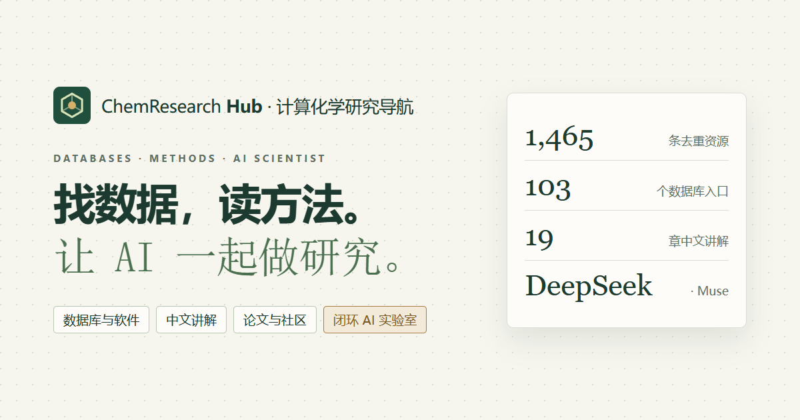

<p align="center"><a href="https://molastria.com/"></a></p>

<h1 align="center">MolAstria</h1>

<p align="center"><b>计算化学研究导航 · A computational chemistry atlas</b><br>
<a href="https://molastria.com/">molastria.com</a> · <a href="https://molastria.com/lab/">AI 实验室 / AI Lab</a> · <a href="https://molastria.com/?lang=en">English</a></p>

数据库、软件、教程、论文与开源工具一处检索，配 19 章中文讲解、资源关系网，以及用 DeepSeek / Meta Muse 驱动的闭环电解液分子发现实验室。全站支持中文 / English、浅色 / 深色，以及 10 种可切换的艺术背景。

One place to search computational-chemistry databases, software, tutorials, papers and open-source tools, with a 19-chapter guide (in Chinese), a resource network, and a closed-loop AI lab for electrolyte molecule discovery powered by DeepSeek or Meta Muse. The whole site switches between Chinese and English, light and dark, and 10 artistic backgrounds.

纯静态网站：`public/` 就是发布目录，不需要后端。 · A static site: `public/` is the published folder; no backend is needed.

## 栏目 · Sections

| 栏目 Section | 路径 Path | 说明 What it does |
| --- | --- | --- |
| 统一搜索 Search | `public/index.html` | 1,465 条去重资源的多关键词检索、筛选、收藏与 CSV 导出；问句自动近似匹配。<br>Keyword search, filters, saved items and CSV export over 1,465 deduplicated resources; natural-language questions fall back to fuzzy matching. |
| 网状查询 Network | `public/hub/network.html` | 来源、主题与数据库的关系图，点节点即跨库查询。<br>A graph of sources, topics and databases; click a node to query across all of them. |
| 讲解与数据库 Guide & databases | `public/atlas/index.html` | 103 条数据库目录、19 章讲解阅读器、Agent 工程说明。<br>103-entry database catalogue, the 19-chapter guide reader, Agent engineering notes. |
| 论文与社区 Papers & community | `public/hub/index.html` | 来源接入状态、内容分布、论文与教程快照。<br>Source status, content charts, paper and tutorial snapshots. |
| 训练 Agent Train an agent | `public/train/index.html` | 用开源小模型训练化学研究 Agent：2026-10 最新小模型（LFM3、Qwen3.5、Gemma 4、Nemotron 3.5、Granite 4.2、MiniCPM5 等）与化学专用模型对比，每个模型可展开详细介绍；数据构造、LoRA、GRPO、评测与本地部署代码。<br>Train a chemistry research agent on an open small model: an October 2026 comparison of small and chemistry-specific models with expandable details, plus data, LoRA, GRPO, evaluation and local-deployment code. |
| Pro 与下载 Pro & downloads | `public/pro/`, `public/download/` | 价格页与结账窗口（Stripe 托管结账，填好 `public/pay/config.js` 的收款链接即可收款，步骤见 [PAYMENTS.md](PAYMENTS.md)），服务条款、退款与隐私政策；Windows / macOS 桌面版下载。<br>Pricing page and checkout window (hosted Stripe checkout: add your links to `public/pay/config.js`, see PAYMENTS.md), terms, refund and privacy pages; Windows and macOS downloads. |
| AI 实验室 AI Lab | `public/lab/index.html` | 闭环电解液分子发现工作台（见下）。<br>Closed-loop electrolyte discovery workbench (below). |
| AI 助手 AI assistant | 每页右上角 · top right | “问目录”先检索本站再带出处作答；“自由提问”直接对话。<br>"Ask the catalogue" retrieves site entries and answers with citations; "Open question" talks to the model directly. |
| 静态页 Static pages | `public/guide/`, `public/resources/` | 给搜索引擎的讲解章节与资源目录（`tools/build-seo.ts` 生成）。<br>Guide chapters and resource directory for search engines, generated by `tools/build-seo.ts`. |

## AI 实验室 · AI Lab

按《Closed-Loop AI Scientist: A Ten-Day Plan for Electrolyte Molecule Discovery》的六步闭环实现。 · Implements the six-step loop of the *Closed-Loop AI Scientist* plan.

1. **提出 Propose** — Muse Wonder / DeepSeek 以 JSON 给出 SMILES 与设计理由，提示词自动带上当前 Pareto 前沿、上一轮被过滤的分子和被 DFT 推翻的判断。<br>The model returns SMILES with a design rationale; the prompt carries the current Pareto front, last round's rejects and DFT-overturned results.
2. **RDKit 过滤 Filter** — 浏览器里的 RDKit.js：元素（C/H/O/F，可放宽 N/S/P/B）、≤ 20 个重原子、危险基团、合成复杂度、InChIKey 去重、与 9 个种子溶剂的相似度。<br>RDKit.js in the browser: allowed elements, ≤ 20 heavy atoms, hazardous groups, synthetic complexity, InChIKey de-duplication, similarity to nine seed solvents.
3. **计算结果 Results** — 生成 rowan-python 脚本（Tier 1 UMA / Tier 2 氧化还原电位 / Tier 3 ωB97M-V，先 `is_draft=True` + `dispatch_info()` 估价），导入 CSV / JSON。<br>Generates rowan-python scripts for the three tiers (estimate first with `is_draft=True` + `dispatch_info()`) and imports CSV / JSON results.
4. **可靠性层 Reliability** — 先验误差、UMA-S/M 分歧、适用域、参考集距离、Rowan 警告，并可用已完成的 DFT 校准。<br>Prior error, UMA-S/M disagreement, applicability domain, distance from the reference set, Rowan warnings, with calibration from finished DFT.
5. **前沿与预算 Front & budget** — IP–EA Pareto 前沿逐轮回放、超体积曲线，在 credits 预算内挑选最值得 DFT 的候选。<br>Round-by-round Pareto replay, hypervolume, and DFT picks within the round's credit budget.
6. **候选卡片 Cards** — 结构图、三级结果、DFT 确认 / 推翻、PubChem 新颖性，导出 Markdown 报告与 CSV。<br>Structures, tier results, DFT confirm / overturn, PubChem novelty, Markdown and CSV export.

「载入演示数据」的分子和过滤是真实的，数值是标注清楚的合成值。 · In the demo, molecules and filtering are real; the property values are clearly labelled synthetic.

## 语言与背景 · Language & backgrounds

- **中文 / English**：右上角 `EN` / `中` 切换，或在网址后加 `?lang=en`。界面文字由 `i18n/en.json` 提供（`tools/i18n-extract.ts` 抽取，`tools/i18n-translate.ts` 用 DeepSeek 补译空缺项，手改的译文不会被覆盖）；论坛帖子标题、讲解正文等原始内容保留原文。<br>Switch with `EN` / `中` in the header or add `?lang=en`. Interface text comes from `i18n/en.json` (extracted by `tools/i18n-extract.ts`; empty entries filled by DeepSeek in `tools/i18n-translate.ts`; hand edits are never overwritten). Source content such as forum titles and guide chapters stays as published.
- **背景 Backgrounds**：调色板按钮里有 10 种——素纸、格物方格、苯环蜂巢、立方晶格、势能面、电子云、分子星图、极光、宣纸、光谱；可调浓淡、开关动态效果，随深浅色自动变色（`public/backdrop.js`）。<br>The palette button offers 10: plain paper, lab notebook, benzene honeycomb, crystal blocks, energy landscape, electron clouds, molecular constellations, aurora, rice paper and spectral lines, with a strength slider and a motion switch; colours follow light / dark mode (`public/backdrop.js`).

## 接入 DeepSeek 与 Muse · Connecting DeepSeek and Muse

**A. 访客自带 key · Bring your own key（默认 default）** — 「AI 助手」→ 设置，选 DeepSeek（`https://api.deepseek.com`，`deepseek-flash` / `deepseek-v4-pro`）、Meta Muse（`https://api.meta.ai/v1`，`muse-spark-1.3` / `muse-wonder-1.0`）或任意 OpenAI 兼容接口。key 默认只存在当前标签页。<br>Open AI assistant → settings and pick DeepSeek, Meta Muse or any OpenAI-compatible API. The key stays in the current tab unless "remember" is ticked.

**B. 站点代理 · Site proxy** — 部署 `deploy/ai-proxy-worker.js` 到 Cloudflare Workers，key 存为 secret，把地址填进 `public/ai/config.js` 的 `proxy`；Worker 会检查来源网站、模型白名单与输出上限。<br>Deploy the Worker, store keys as secrets and set `proxy` in `public/ai/config.js`; the Worker checks the calling site, allowed models and output limits.

```powershell
$env:DEEPSEEK_API_KEY = "<key>"; deno run --allow-net --allow-env --allow-read tools/proxy-local.ts 8831 http://localhost:8830
```

## 发布与更新 · Publishing and updates

推送到 `main` 后，`.github/workflows/pages.yml` 会跑测试、重新生成 SEO 页面和 sitemap，并发布到 **https://molastria.com/**（`public/CNAME`）。Search Console 用 DNS TXT 验证 `molastria.com` 网域资源，再提交 `https://molastria.com/sitemap.xml`。<br>Pushing to `main` runs the tests, rebuilds the SEO pages and sitemap, and deploys to molastria.com. Verify the `molastria.com` domain in Search Console with a DNS TXT record, then submit the sitemap.

```powershell
deno run --allow-net --allow-read tools/serve.ts 8830              # 本地预览 · local preview of public/
deno run --allow-read --allow-write tools/build-seo.ts             # SEO 页面与 sitemap · SEO pages and sitemap
deno run --allow-read --allow-write tools/i18n-extract.ts          # 抽取界面文字 · collect UI strings
deno run --allow-read --allow-write --allow-net --allow-env tools/i18n-translate.ts   # 补译并生成 public/i18n/en.js
deno run --allow-read --allow-write tools/theme.ts                 # 首页与 Atlas 的深色配色 · dark palette
deno run --allow-read --allow-write tools/bundle-single.ts         # 单文件离线版 · single-file offline build
node --test tools/lab-test.mjs                                     # 实验室逻辑测试 · lab logic tests
```

**桌面版新版本 · Desktop releases.** 推送标签 `desktop-v0.1.2` 这样的版本号，`.github/workflows/desktop.yml` 会以标签里的版本号构建 Win 安装包和 Mac 磁盘镜像，用仓库密钥 `TAURI_SIGNING_PRIVATE_KEY` 给更新文件签名，并发布 `latest.json`。已安装的桌面版每次启动都会读取它，发现新版本就在右下角提示“立即更新”，下载、校验签名、安装并重启。签名私钥只存在站长电脑（`~/.tauri/molastria-updater.key`）和这个仓库密钥里，请另外备份；丢了它，旧版本就再也收不到更新。<br>Push a tag such as `desktop-v0.1.2`: the workflow builds both installers with that version, signs the update files with the `TAURI_SIGNING_PRIVATE_KEY` secret and publishes `latest.json`. Installed apps read it on every launch and offer "Update now", which downloads, verifies, installs and restarts. Back up the private key; without it, installed apps can never be updated again.

```powershell
git tag desktop-v0.1.2; git push origin desktop-v0.1.2
```

## 文件结构 · Layout

```text
public/                     发布目录 · published site
  index.html, app.js         统一搜索 · search
  shared-nav.css/.js         顶栏、主题、语言与背景按钮 · header, theme, language and background buttons
  i18n.js, i18n/en.js        中英切换与英文词典 · language switch and English dictionary
  backdrop.js                10 种艺术背景 · artistic backgrounds
  ai/                        AI 接入层与助手 · AI layer and assistant
  lab/                       AI 实验室 · AI Lab
  atlas/, hub/               讲解与数据库、论文与社区 · guide, papers & community
  guide/, resources/         生成的静态页 · generated static pages
i18n/en.json                 英文译文源文件 · English strings (editable)
desktop/                     Tauri 桌面版（Win + Mac，GitHub Actions 构建）· desktop app
PAYMENTS.md                  开通收款步骤 · how to turn on payments
deploy/ai-proxy-worker.js    可选 AI 代理 · optional AI proxy
tools/                       构建、翻译、测试脚本 · build, translation and test scripts
maintenance/                 数据更新工具（Python）· data refresh tools (Python)
site.config.json             正式网址与站名 · site URL and name
```

## 数据与局限 · Data and limits

目录数据为 2026-10-27 快照，未重新抓取外部网站；全文与使用许可以原站为准。实验室的局限：电位工作流溶剂固定为乙腈，只适合相对排序；忽略阴离子与电极界面；不考虑黏度、闪点等宏观性质；合成复杂度是启发式近似。<br>The catalogue is a 2026-10-27 snapshot; full text and licences belong to the original sites. Lab limits: the redox workflow uses acetonitrile, so potentials suit relative ranking only; anions and the electrode interface are ignored; bulk properties such as viscosity and flash point are not considered; synthetic complexity is a heuristic.
