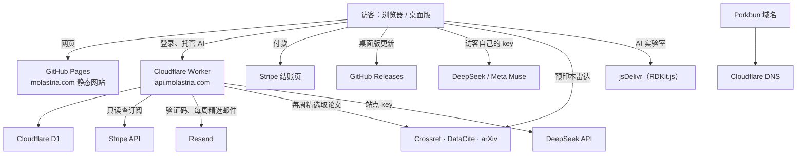
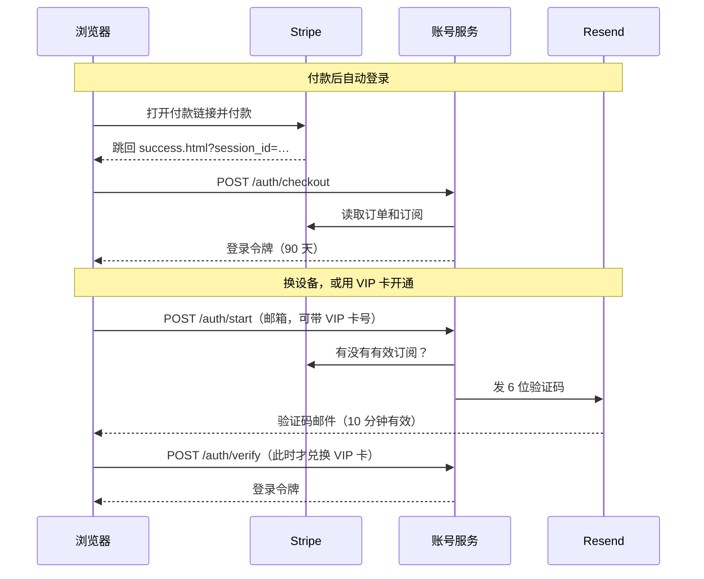

# 系统结构

## 总览

- **网站**是静态文件：搜索、关系网、讲解、实验室、雷达都在访客浏览器里运行。
- **账号服务**只有一个 Worker，负责登录、查订阅、计次数、转发托管 AI，并按时生成和发送每周精选。
- **桌面版**（Tauri）内置同一套网页，只多了检查更新。
- 网站不接触卡号；AI 对话内容不保存。

## 付款和登录

一个邮箱的权限按这个顺序判断（`access()`）：自己的 Stripe 订阅 → `grants` 里的站长 → 兑换过的 VIP 卡 → 别人课题组的席位 → 免费。

## 托管 AI 怎么计次

| 请求 | 计几次 |
| --- | --- |
| 普通问答（输入 ≤ 12,000 字，输出上限 ≤ 4,096 token） | 1 |
| 更长的输入或更高的输出上限（如 AI 实验室一轮，输出上限 12,000） | 按比例向上取整 |
| `deepseek-v4-pro` | 以上再乘 3 |
| 短调用（输出上限 ≤ 400 且输入 ≤ 2,000 字） | 单独计数，额度是正式问答的 2 倍；模型倍数同样适用 |
| 输入超过 48,000 字，或含非文字内容 | 拒绝，不计 |
| 上游失败 | 退回 |

每席每月 300 次（`MONTHLY_ASKS`）。这些规则在 `deploy/account-worker.js`，倍数在 `wrangler.toml` 的 `HOSTED_MODEL_WEIGHTS`。

## 每周精选怎么运行

代码在 `deploy/digest.js`，定时任务写在 `wrangler.toml`。

| 步骤 | 什么时候 | 做什么 |
| --- | --- | --- |
| 生成 | 周一 12:00–20:00（UTC）每小时试一次，本周已有就跳过 | 从 Crossref（ChemRxiv、JCTC、JCP、PCCP、JPCL）和 DataCite（arXiv physics.chem-ph）取新论文，`deepseek-flash` 选题并写中英解读；失败时存不带解读的列表 |
| 发送 | 每 15 分钟 | 给还没收到本周这一期的订阅者发最多 5 封，每天最多 80 封；已不是 Pro 的人记为跳过 |

论文标题公开（`GET /digest/preview`，Pro 页显示）；完整内容和邮件要 Pro。邮件里的退订链接带每人一个的随机令牌，退订时删除订阅和发送记录。

## 账号服务接口

`deploy/account-worker.js` 开头有完整列表。所有接口返回 JSON，登录后带 `Authorization: Bearer <令牌>`。

## 数据库（D1）

结构见 `deploy/schema.sql`。

| 表 | 内容 |
| --- | --- |
| `sessions` | 登录令牌的哈希 |
| `accounts` | 从 Stripe 查到的订阅摘要（缓存，每 6 小时复核） |
| `codes` | 验证码的哈希，以及待兑换的 VIP 卡 |
| `members` | 课题组成员 |
| `grants` | 站长 |
| `cards` | VIP 卡和兑换记录 |
| `usage` | 每人每月的 AI 次数 |
| `throttle` | 频率限制计数 |
| `digests` | 每周精选的内容，每周一条 |
| `digest_subs` | 订阅者：邮箱、退订令牌、语言 |
| `digest_sends` | 哪一期发给了谁，用来分批和续发 |

## 数据和密钥放在哪

| 位置 | 内容 |
| --- | --- |
| Worker 密钥 | `STRIPE_KEY`（只读受限密钥）、`RESEND_API_KEY`、`DEEPSEEK_API_KEY` |
| GitHub 仓库密钥 | `TAURI_SIGNING_PRIVATE_KEY`（桌面版更新签名） |
| 站长的电脑 | 同一把签名私钥 `~/.tauri/molastria-updater.key`，wrangler 登录凭据 |
| 访客浏览器 | 访客自己的 AI key（勾选“记住”才保存）、登录令牌、雷达的主题和收藏、语言和背景偏好 |

## 用到的服务和费用

价格是 2026-10-29 在各服务商官网查到的（Porkbun 来自第三方价格追踪），会变。

| 服务 | 用途 | 费用 |
| --- | --- | --- |
| Porkbun | 域名 | 约 US$11/年 |
| Stripe | 收款 | 2.9% + C$0.30；境外卡 +0.8%；换汇 +2%；订阅 +0.7% |
| DeepSeek | 托管 AI、每周精选、补译 | 按 token；flash 每百万 $0.30 / $1.20（高峰，非高峰减半） |
| Cloudflare Workers | 账号服务 | 免费：每天 10 万次请求；超出后 Workers Paid US$5/月起 |
| Cloudflare D1 | 数据库 | 免费：每天读 500 万行、写 10 万行，5 GB |
| Cloudflare DNS | 解析 | 免费 |
| Resend | 验证码和每周精选邮件 | 免费：每天 100 封、每月 3000 封；超出后 Pro US$20/月 |
| GitHub Pages | 网站 | 免费：1 GB，带宽软上限 100 GB/月 |
| GitHub Actions、Releases | 构建、发布 | 公开仓库免费 |
| Crossref、DataCite、arXiv、jsDelivr | 数据和 CDN | 免费 |

每周精选每周调用一次 `deepseek-flash`（最多 3,000 token 输出），费用不到一分钱量级；主要限制是 Resend 的每日封数。

## 自动运行的东西

| 工作流 | 什么时候 | 做什么 |
| --- | --- | --- |
| `.github/workflows/pages.yml` | 推到 `main` | 测试、生成 SEO 页、发布网站 |
| `.github/workflows/desktop.yml` | 推 `desktop-v*` 标签 | 构建 Win/Mac，签名，发布 Release 和 `latest.json` |
| `.github/workflows/health.yml` | 每周一，以及推到 `main` 时 | 浏览器端到端测试；定时运行时还检查线上。失败时 GitHub 发邮件 |
| Worker 定时任务（`wrangler.toml`） | 周一 12:00–20:00（UTC）每小时；每 15 分钟 | 生成每周精选；发送每周精选 |
