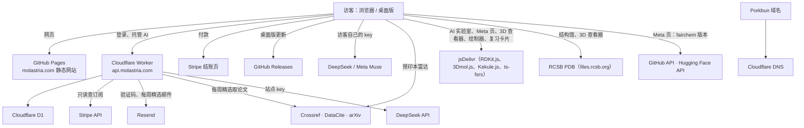
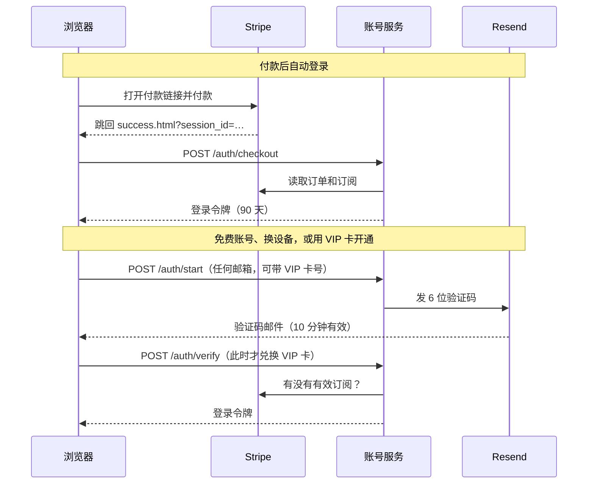

# 系统结构

## 总览



- **网站**是静态文件：搜索、关系网、讲解、实验室、Meta 页、雷达、量子化学计算都在访客浏览器里运行。关系网的实体与连线在打开页面时由目录快照现算（`hub/net-engine.js`，约 0.1–0.3 秒）；术语表认不出的查询只记在访客浏览器的 `molastria-net-misses`（`hub/net-misses.js`），不发到任何服务器，访客自己决定要不要复制出来或提交 GitHub Issue。Meta 页的识图把图片直接发给 Meta（访客自己的 Muse key），UMA 只生成脚本，在访客自己的机器上运行。几个较大的第三方库（RDKit.js、3Dmol.js、Kekule.js、ts-fsrs）不进仓库，第一次用到时从 jsDelivr 按固定版本载入，载不到时页面照常能用；复习卡片的进度只存在浏览器的 `molastria-review`，研习台的 `molastria-learn` 它只读不写。
- **账号服务**只有一个 Worker，负责登录、查订阅、计次数、转发托管 AI，并按时生成和发送每周精选；还把 `/uma/*` 经 Cloudflare Tunnel 转给站长电脑上的在线模型服务（15 个模型：UMA、OMol25 的 eSEN / AllScAIP、MACE、ANI-2x；决定谁能用哪个、限次、地区限制、共享暗号）。同一个队列也开给程序：`/v1/*` 用账号页生成的 API key（D1 的 `api_keys` 表只存哈希），不查来源网站，次数算在 key 的主人头上，MACE 系列不提供。
- **桌面版**（Tauri）内置同一套网页，多了检查更新和“在本机运行 UMA”：`desktop/src-tauri/src/uma.rs` 找到访客的 Python，用编译进应用的 `uma/runner.py` 计算；页面只传经过校验的参数（SMILES、任务、模型等），日志靠轮询 `uma_poll` 取回。
- **研习台**（`/learn/`）也完全在浏览器里：页面直接调用访客选的 AI（自己的 key 发往 DeepSeek / Muse / OpenAI 兼容服务，或经账号服务的托管额度），模型只回 JSON，校验后由页面自己画；会话、知识图和改过的提示词只存在 `localStorage`，不经过账号服务。作为依据的栏目数据文件（如 `quantum/physics/qp-data.js`）用到时才加载。
- 网站不接触卡号；AI 对话内容不保存。

## 开放数据接口

给程序和别人的网页用的出口，全部是静态文件，不经过账号服务：

```text
各栏目的数据文件（atlas/content.js、journals-data.js、scimodels-data.js、videos-data.js、search-terms.js、i18n/en.json）
        │  tools/build-api.mjs（本地手动跑；发布时 CI 再跑一次）
        ▼
public/api/v1/*.json、openapi.json、public/llms.txt          chemdb-agent 的 catalog/resources.json（同一份目录）
        │  GitHub Pages（允许跨域读取）
        ▼
v1/molastria.mjs（JS 库：取数据、搜索）  →  api/embed.js（别人网页上的卡片）、/api/ 说明页的搜索台、任何程序
```

没有 key、没有计数、没有服务器端的搜索；要按次数分档或开放计算时再接账号服务（`docs/DECISIONS.md` 2026-11-09）。

计算不在这里：给程序用的计算接口在账号服务里（`api.molastria.com/v1`，要 API key），说明写在同一个 `/api/` 页的“计算接口”一段（`compute.js`）。三种现成的用法都只是这个接口的客户端：一个文件的 Python 客户端 `public/api/v1/molastria.py`、chemdb-agent 的 `run_calculation` 等三个 MCP 工具、说明页上的“带上 key 试一次”。

```text
程序（带 Authorization: Bearer mola_…）  →  账号服务 /v1/*：查 key（api_keys，只存哈希）、挡住 MACE、按账号计次
        →  和网站的 /uma/* 同一段代码  →  Cloudflare Tunnel  →  站长电脑上的 tools/uma-server（RTX 2080，可能离线）
```

账号服务另外记两样东西：每次用 key 提交记一行 `api_jobs`（模型、计算种类、花费、时间，不存分子，留 30 天），账号页的用量面板读它；每 15 分钟的定时任务探测一次站长电脑，累加进 `status` 表的 `uptime` 一行，`GET /v1/status`（不要 key）和说明页的 7 天在线率读它。

## 付款和登录



一个邮箱的权限按这个顺序判断（`access()`）：自己的 Stripe 订阅 → `grants` 里的站长 → 兑换过的 VIP 卡 → 别人课题组的席位 → 免费账号。免费账号的托管 AI 每 24 小时 `FREE_DAILY_ASKS`（5）次，记在 `throttle` 表（`aifree:` 和短调用的 `aifree-aux:`），计法和 Pro 相同；Pro 记在 `usage` 表，按月。

## 托管 AI 怎么计次

| 请求 | 计几次 |
| --- | --- |
| 普通问答（输入 ≤ 12,000 字，输出上限 ≤ 4,096 token） | 1 |
| 更长的输入或更高的输出上限（如 AI 实验室一轮，输出上限 12,000） | 按比例向上取整 |
| `deepseek-v4-pro` | 以上再乘 3 |
| 短调用（输出上限 ≤ 400 且输入 ≤ 2,000 字） | 单独计数，额度是正式问答的 2 倍；模型倍数同样适用 |
| 输入超过 48,000 字，或含非文字内容 | 拒绝，不计 |
| 上游失败 | 退回 |

每席每月 300 次（`MONTHLY_ASKS`）。这些规则在 `deploy/account-worker.js`，倍数在 `wrangler.toml` 的 `HOSTED_MODEL_WEIGHTS`。

## 每周精选怎么运行

代码在 `deploy/digest.js`，定时任务写在 `wrangler.toml`。

| 步骤 | 什么时候 | 做什么 |
| --- | --- | --- |
| 生成 | 周一 12:00–20:00（UTC）每小时试一次，本周已有就跳过 | 从 Crossref（ChemRxiv、JCTC、JCP、PCCP、JPCL）和 DataCite（arXiv physics.chem-ph）取新论文，`deepseek-flash` 选题并写中英解读；失败时存不带解读的列表 |
| 发送 | 每 15 分钟 | 给还没收到本周这一期的订阅者发最多 5 封，每天最多 80 封；免费账号也发 |

完整一期和点评公开（`GET /digest/preview`，精选页和价格页显示）；订阅邮件要登录（免费账号即可）。邮件里的退订链接带每人一个的随机令牌，退订时删除订阅和发送记录。

## 账号服务接口

`deploy/account-worker.js` 开头有完整列表。所有接口返回 JSON，登录后带 `Authorization: Bearer <令牌>`。

## 数据库（D1）

结构见 `deploy/schema.sql`。

| 表 | 内容 |
| --- | --- |
| `sessions` | 登录令牌的哈希 |
| `accounts` | 从 Stripe 查到的订阅摘要（缓存，每 6 小时复核） |
| `codes` | 验证码的哈希，以及待兑换的 VIP 卡 |
| `members` | 课题组成员 |
| `grants` | 站长 |
| `cards` | VIP 卡和兑换记录 |
| `usage` | 每人每月的 AI 次数 |
| `throttle` | 频率限制计数 |
| `digests` | 每周精选的内容，每周一条 |
| `digest_subs` | 订阅者：邮箱、退订令牌、语言 |
| `digest_sends` | 哪一期发给了谁，用来分批和续发 |

## 数据和密钥放在哪

| 位置 | 内容 |
| --- | --- |
| Worker 密钥 | `STRIPE_KEY`（只读受限密钥）、`RESEND_API_KEY`、`DEEPSEEK_API_KEY` |
| GitHub 仓库密钥 | `TAURI_SIGNING_PRIVATE_KEY`（桌面版更新签名） |
| 站长的电脑 | 同一把签名私钥 `~/.tauri/molastria-updater.key`，wrangler 登录凭据 |
| 访客浏览器 | 访客自己的 AI key（勾选“记住”才保存）、登录令牌、雷达的主题和收藏、语言和背景偏好 |

## 用到的服务和费用

价格是 2026-10-29 在各服务商官网查到的（Porkbun 来自第三方价格追踪），会变。

| 服务 | 用途 | 费用 |
| --- | --- | --- |
| Porkbun | 域名 | 约 US$11/年 |
| Stripe | 收款 | 2.9% + C$0.30；境外卡 +0.8%；换汇 +2%；订阅 +0.7% |
| DeepSeek | 托管 AI、每周精选、补译 | 按 token；flash 每百万 $0.30 / $1.20（高峰，非高峰减半） |
| Cloudflare Workers | 账号服务 | 免费：每天 10 万次请求；超出后 Workers Paid US$5/月起 |
| Cloudflare D1 | 数据库 | 免费：每天读 500 万行、写 10 万行，5 GB |
| Cloudflare DNS | 解析 | 免费 |
| Resend | 验证码和每周精选邮件 | 免费：每天 100 封、每月 3000 封；超出后 Pro US$20/月 |
| GitHub Pages | 网站 | 免费：1 GB，带宽软上限 100 GB/月 |
| GitHub Actions、Releases | 构建、发布 | 公开仓库免费 |
| Crossref、DataCite、arXiv、jsDelivr、RCSB PDB | 数据和 CDN | 免费 |
| Cloudflare Tunnel | 把站长电脑上的在线模型服务（`tools/uma-server`）接到账号服务，不开入站端口 | 免费 |
| Google Cloud（站长自己的 L4 虚拟机） | AI 实验室的批量 UMA / MACE-OFF23 计算，不对外服务（`tools/cloud/`） | 按开机时长计费，算完自动关机，最长 2 小时 |

每周精选每周调用一次 `deepseek-flash`（最多 3,000 token 输出），费用不到一分钱量级；主要限制是 Resend 的每日封数。

## 自动运行的东西

| 工作流 | 什么时候 | 做什么 |
| --- | --- | --- |
| `.github/workflows/pages.yml` | 推到 `main` | 测试、生成 SEO 页、发布网站 |
| `.github/workflows/desktop.yml` | 推 `desktop-v*` 标签 | 构建 Win/Mac，签名，发布 Release 和 `latest.json` |
| `.github/workflows/refresh-data.yml` | 每周四 13:00（UTC），也可手动运行 | 爬取各来源、合并目录、刷新 ChemRxiv，`tools/check-catalogue.mjs` 检查条目没有大幅减少后提交，再触发网站发布 |
| `.github/workflows/health.yml` | 每周一，以及推到 `main` 时 | 浏览器端到端测试；定时运行时还检查线上。失败时 GitHub 发邮件 |
| Worker 定时任务（`wrangler.toml`） | 周一 12:00–20:00（UTC）每小时；每 15 分钟 | 生成每周精选；发送每周精选 |
